# Reel by Alex AI

- **URL:** https://www.instagram.com/reel/DegiJfWlFSX/?psln=MTYycnh0amxqdHFyNQ==
- **Shared:** 2026-10-15 11:44 UTC
- **Duration:** 36s
- **Spoken language:** en

## Caption

Comment "GIANT" and I'll DM you the link to AirLLM, the open-source library that runs the biggest open AI model on a graphics card with under 4GB of memory. Follow so the DM lands 📩

👇 READ BELOW: how it fits, and the catch.

1. Per its README, AirLLM runs Kimi K3, a 2.8 trillion parameter model and the largest open model released to date, in 3.72 GB of GPU memory.

2. It loads one layer of the model onto the GPU at a time, runs it, frees it, then loads the next. The memory you need depends on one layer, not the whole model.

3. The same trick runs a 70 billion parameter model, normally about 140GB at 16-bit, on a single 4GB card, without quantization.

4. It's free and open source (Apache-2.0, over 38,000 stars on GitHub). The guide has the install, the code to paste in and a setup prompt for Claude.

The catch: it's slow, because every layer is read from your disk, and you need lots of free disk space for the split model. It needs an NVIDIA GPU or an Apple silicon Mac.

For the link, comment "GIANT".

#claudeai #claudecode #claude #claudetips

## Transcript

[0:00] Someone open sourced a way to run the biggest open model on your cheap graphics card.
[0:04] So Kimi K3, a model with 2.8 trillion parameters, runs on less than 4 gigabytes of graphics memory.
[0:10] Basically, it loads one layer of the model at a time, runs it, then loads the next.
[0:14] And get this, the same trick runs a 70 billion parameter model,
[0:18] which normally needs about 140 gigabytes on a 4 gigabyte card.
[0:21] But it's slow because every layer comes off your disk, so you need lots of free space.
[0:26] So you paste one prompt into Claude and it installs everything and runs your first model for you.
[0:30] It's called Air LLM, and it's already past 35,000 stars.
[0:34] For the link, comment giant.

## Frames

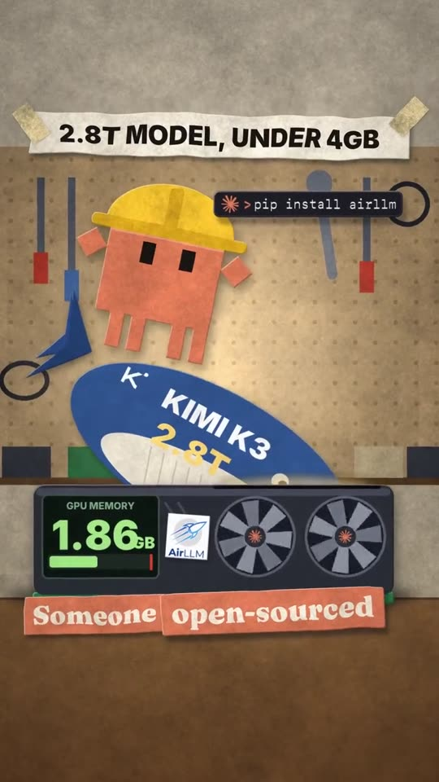 at 1s
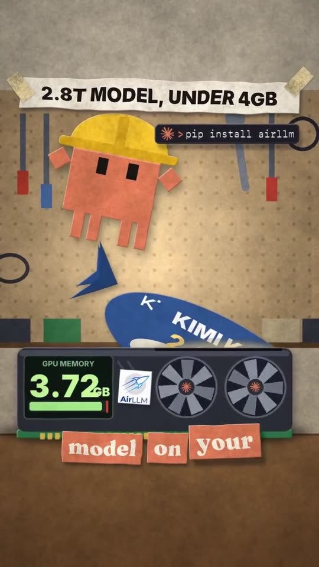 at 3s
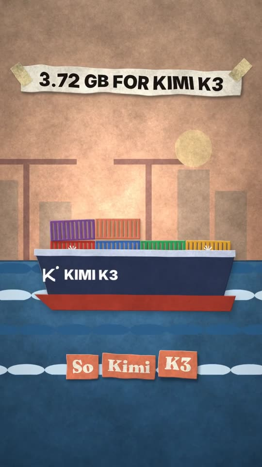 at 5s
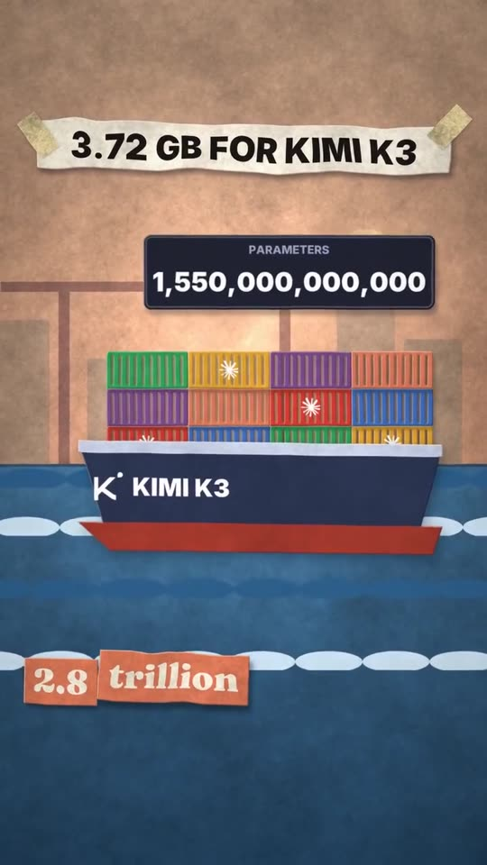 at 7.1s
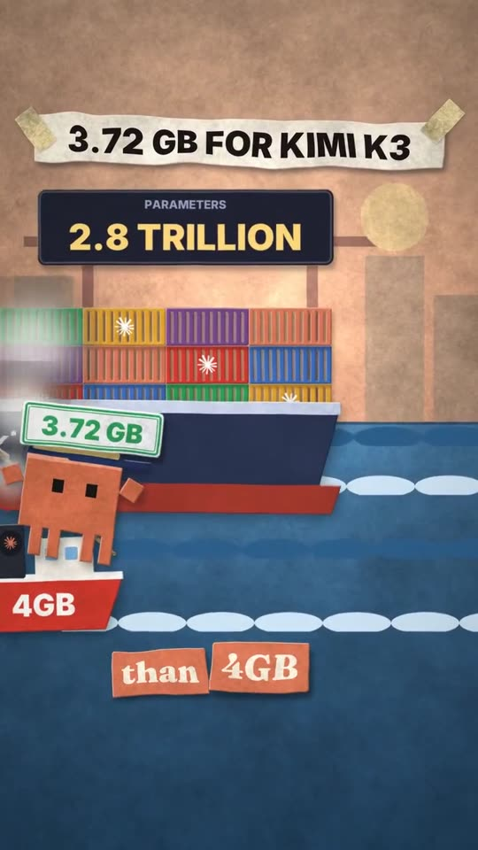 at 9.1s
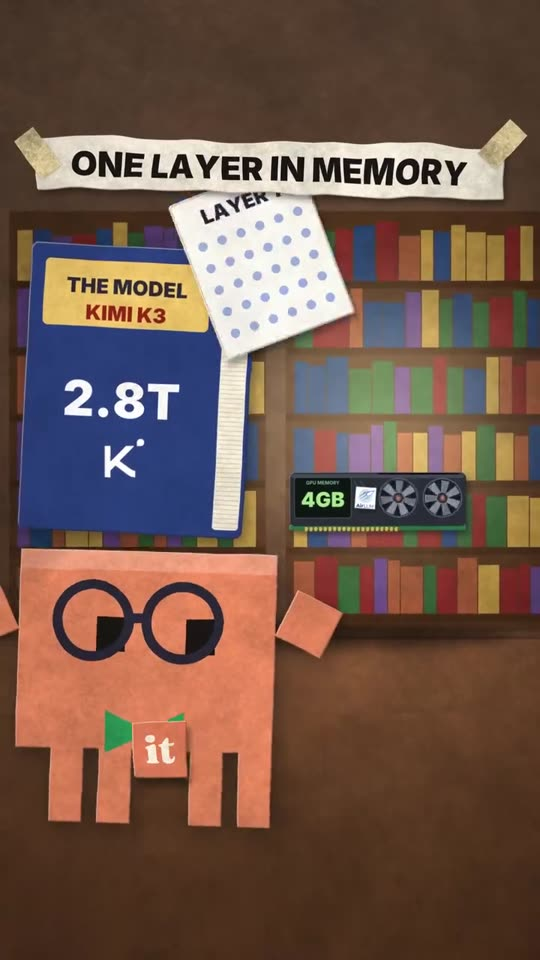 at 11.1s
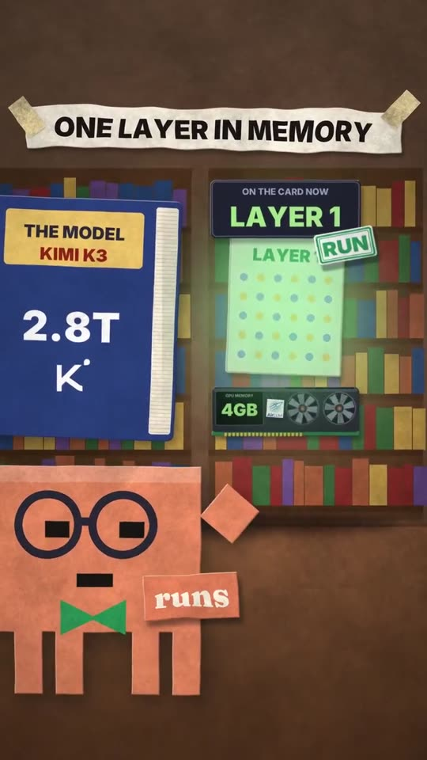 at 13.1s
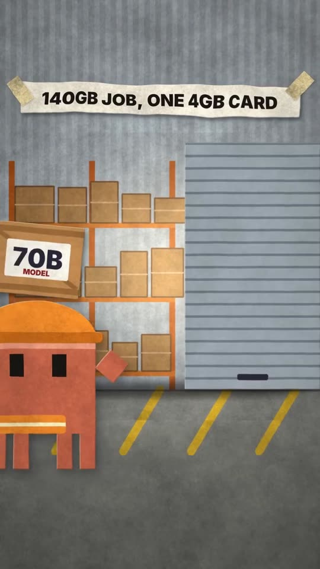 at 15.1s
 at 17.1s
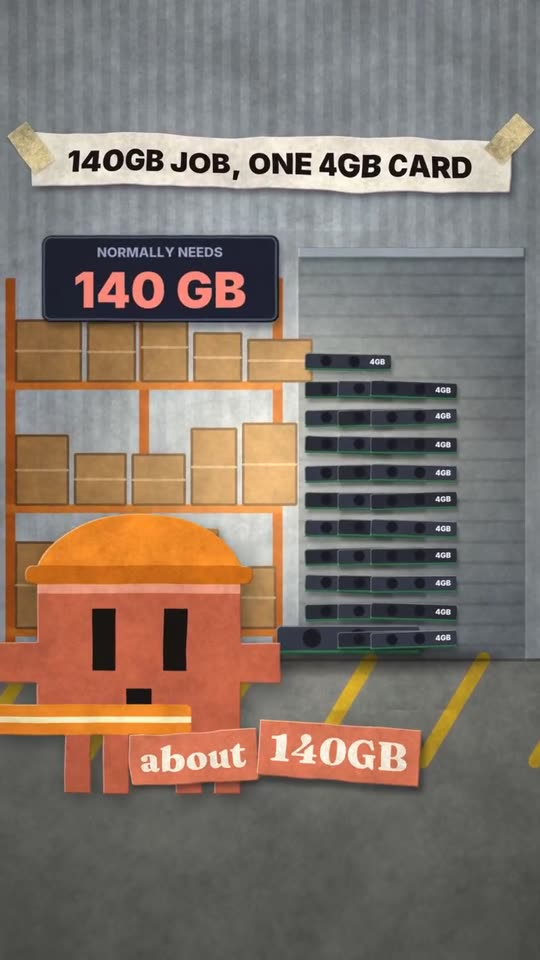 at 19.2s
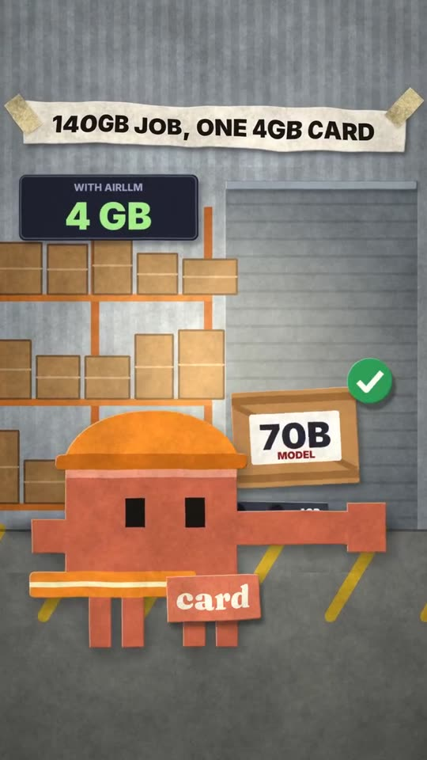 at 21.2s
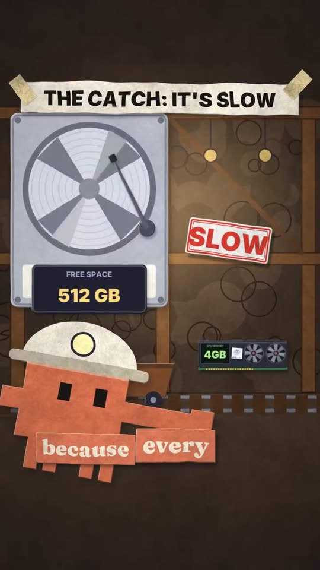 at 23.2s
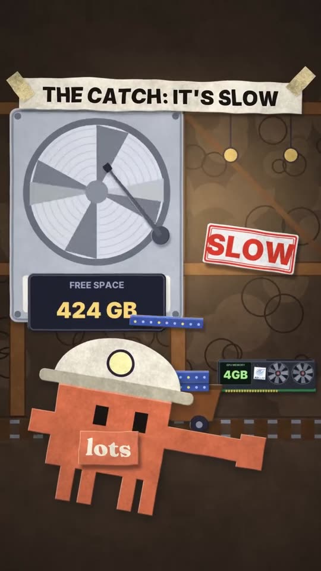 at 25.2s
 at 27.2s
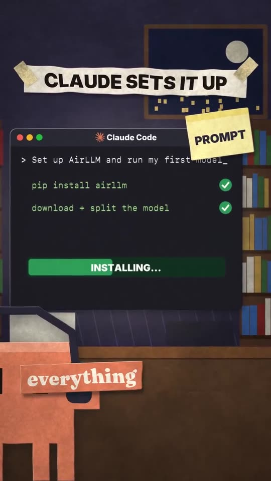 at 29.2s
 at 31.2s
 at 33.3s
 at 35.3s
