# Reel by Marc Kaz

- **URL:** https://www.instagram.com/reel/DbEK3bustQ7/?dlrf=ZHZ6dHB5YmdqMWQ5
- **Shared:** 2026-10-16 18:30 UTC
- **Duration:** 32s
- **Spoken language:** en

## Caption

🚨 MICROSOFT OPEN-SOURCED SELF-EVOLVING AGENT SKILLS

SkillOpt lets skills improve themselves. A base model runs the task, an optimizer rewrites the instructions based on results.

Ships with:
• Isolates successful paths from failures
• Auto-rejects edits that don’t beat the benchmark
• Beats hand-crafted prompts and TextGrad
• Zero lock-in, transfers to any model

100% free. Open source.

👉 https://github.com/microsoft/SkillOpt

Who’s evolving their agent skills today? Drop a 🔥

## Transcript

[0:00] What's up guys so Microsoft just open sourced self-evolving agent skills
[0:06] Okay skills that improve themselves the same way you train an AI model
[0:11] So no more guessing whether your prompt weeks helped again
[0:15] Very fun open source 100% free
[0:19] Someone can use this
[0:22] It optimizes the outputs and evaluates them and rewrites the instructions themselves, you know
[0:28] It's agents agent skill builder dude. Come on now

## Frames

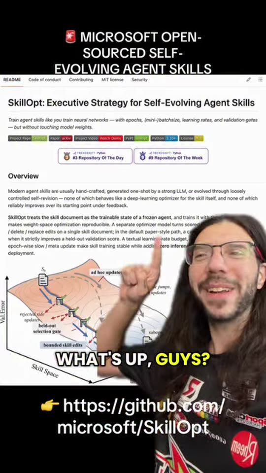 at 1s
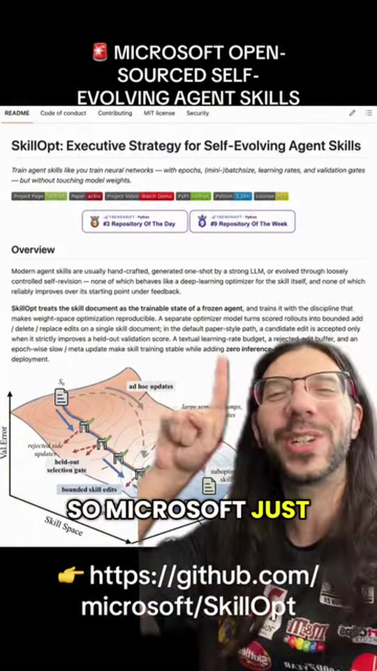 at 3s
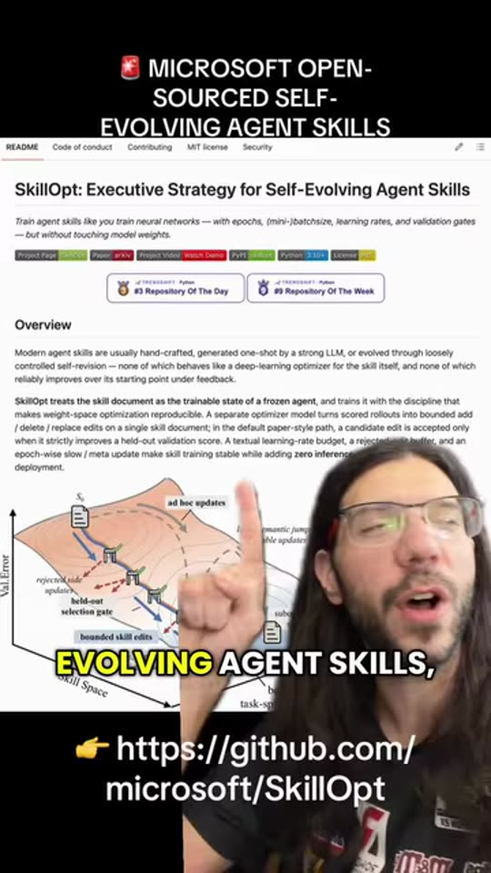 at 5s
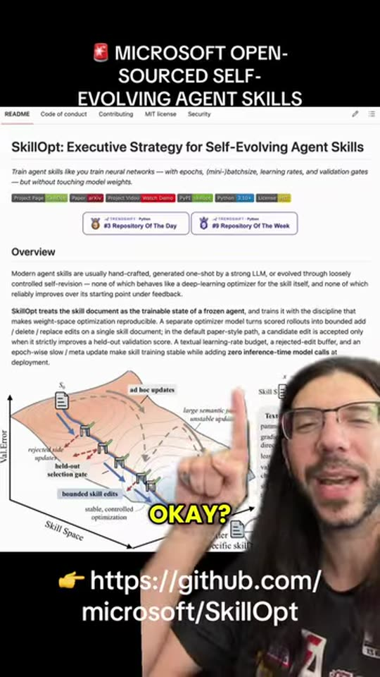 at 7.1s
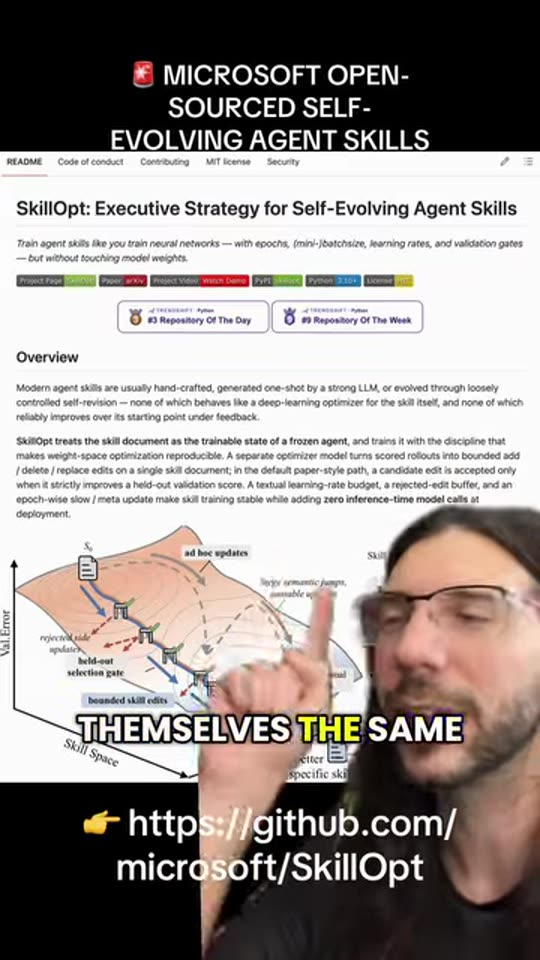 at 9.1s
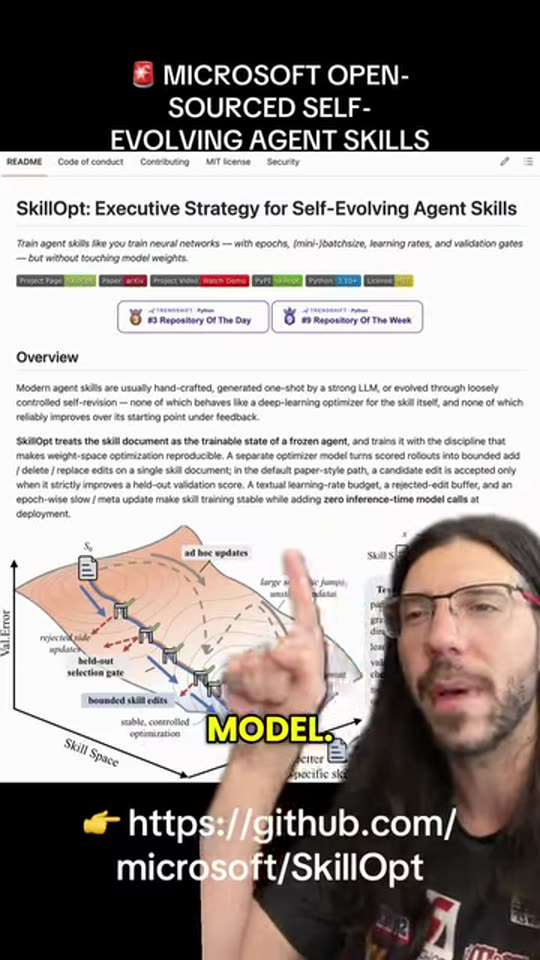 at 11.1s
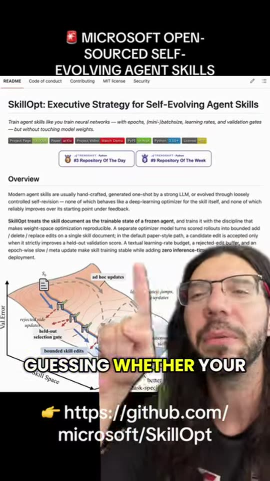 at 13.1s
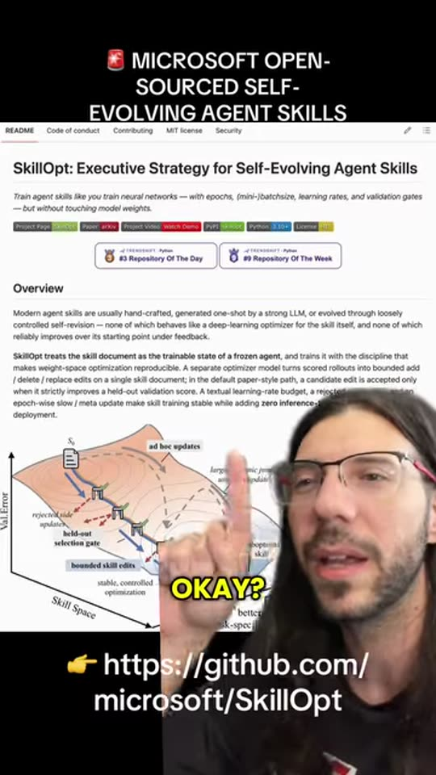 at 15.1s
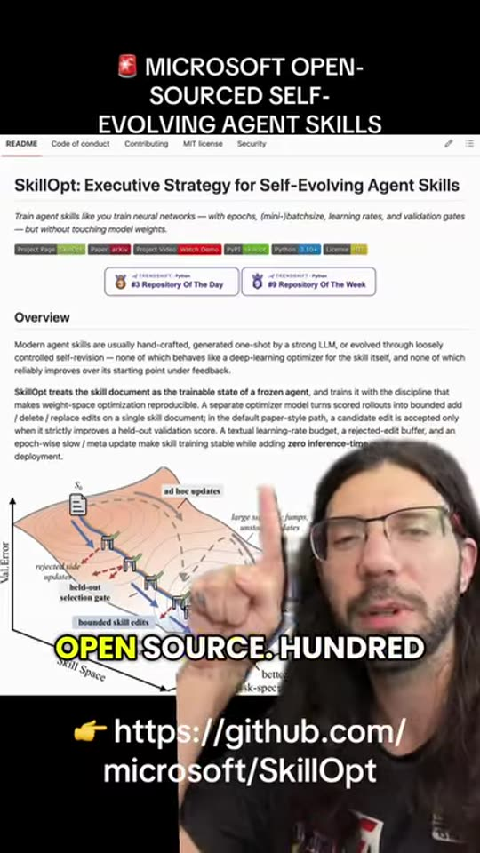 at 17.1s
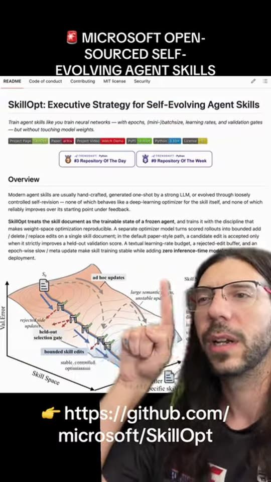 at 19.2s
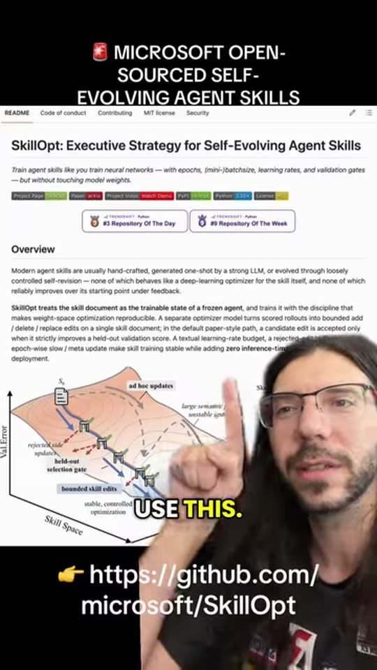 at 21.2s
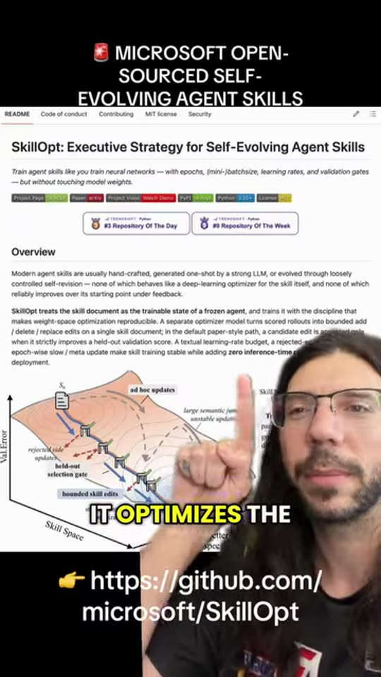 at 23.2s
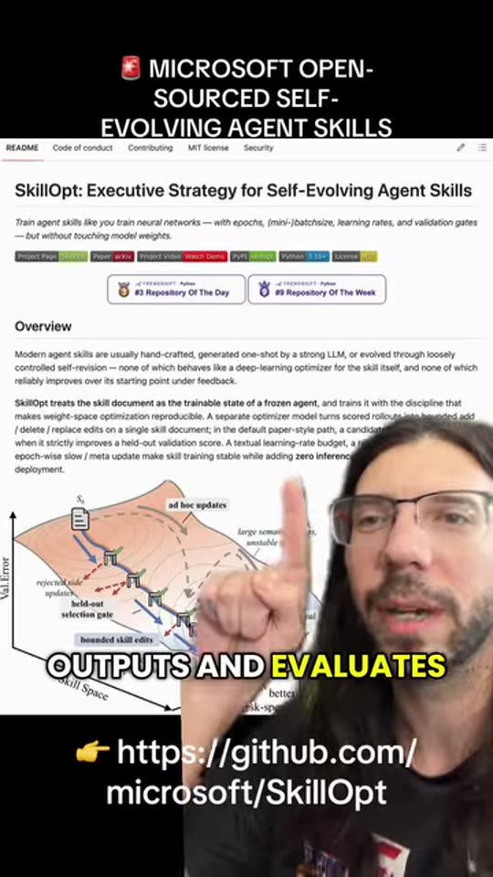 at 25.2s
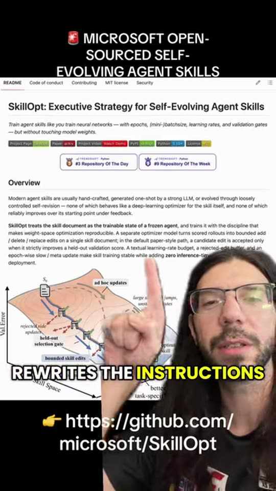 at 27.2s
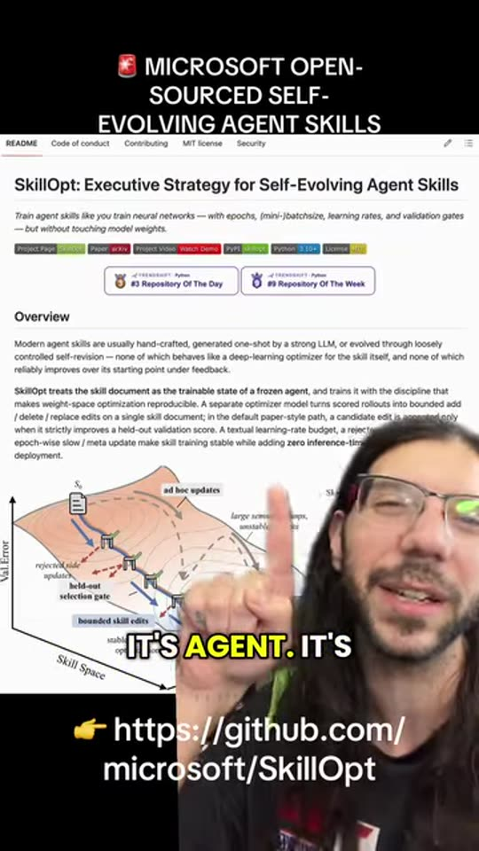 at 29.2s
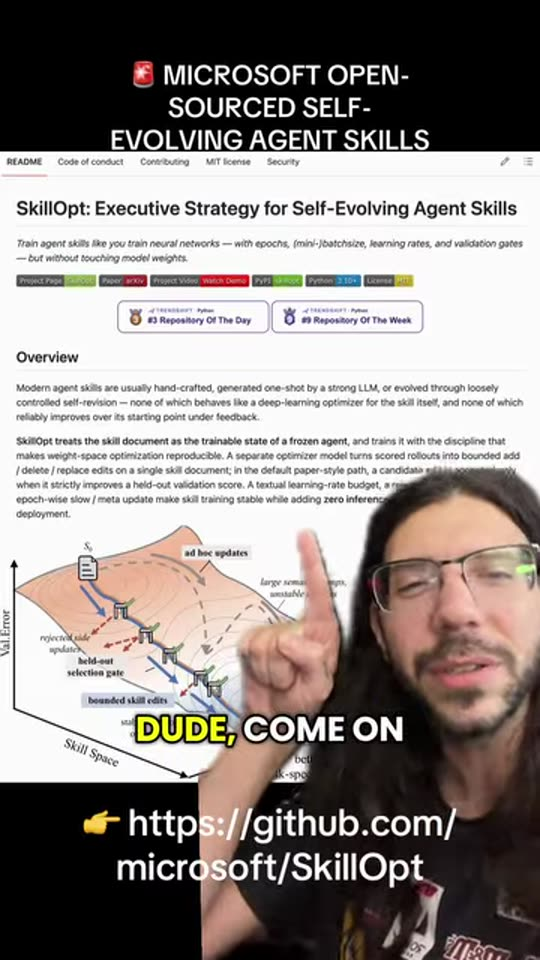 at 31.2s
