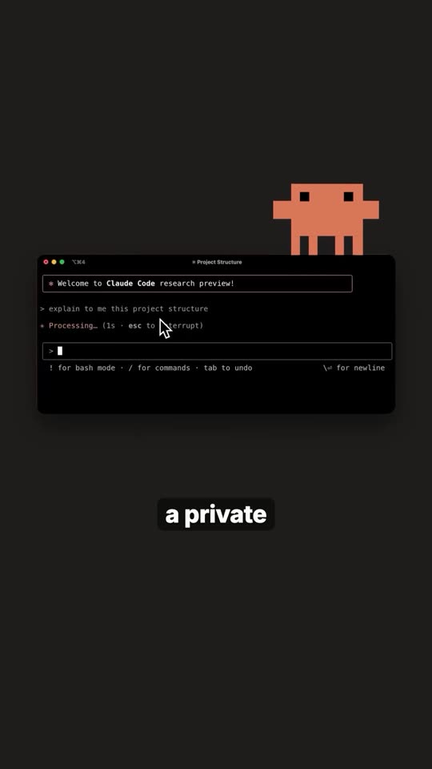
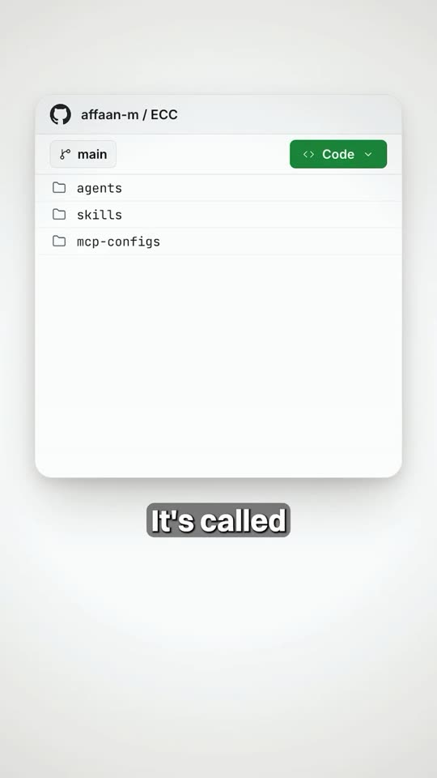
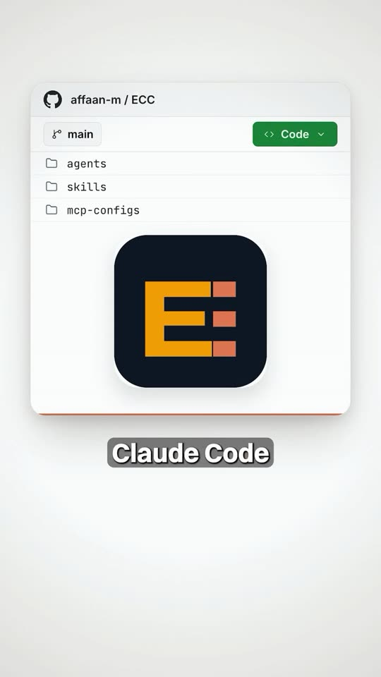
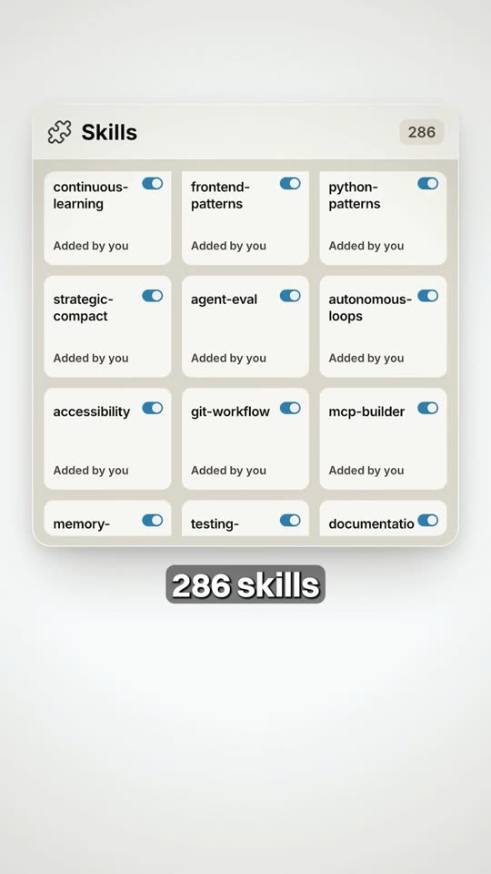
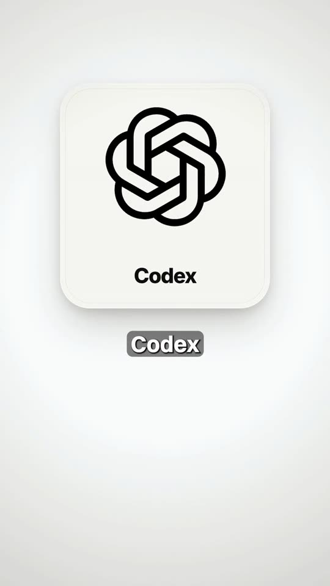
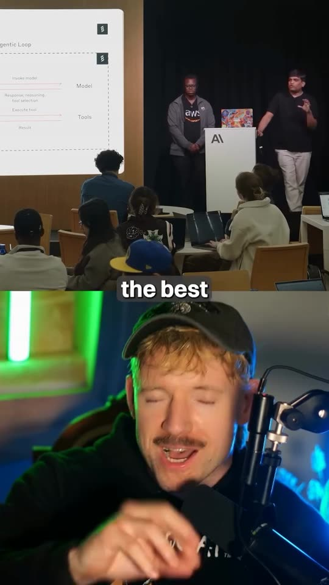
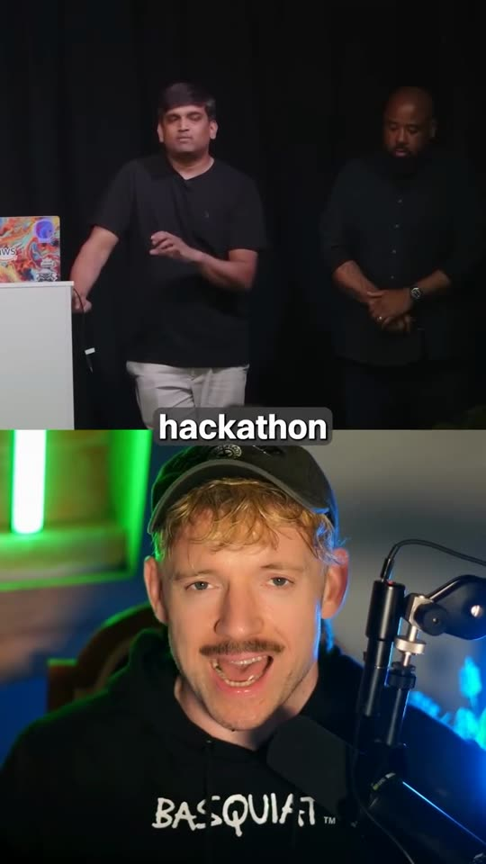

# Reel by Jack Roberts

- **URL:** https://www.instagram.com/reel/DeheVnTD9Fd/?obrf=MWJkY3Rqcjdsa2NjbQ==
- **Shared:** 2026-10-16 18:22 UTC
- **Duration:** 39s
- **Spoken language:** en

## Caption

Comment "STACK" and I'll send you the whole setup.

Ten months of private Claude Code tuning just went public.

It's free on GitHub.

It's called Everything Claude Code.

286 skills and 68 subagents.

Basically a dev team in a folder.

One skill scans your code for security holes.

One keeps your memory clean.

One learns from your past sessions.

And it isn't locked to Claude Code.

It runs on Cursor, Codex, Encode and Gemini too.

Like inheriting a toolbox someone spent ten months filling.

Every tool already sharpened.

He won Anthropic's own hackathon with this setup.

So you know it holds up.

#everythingclaudecode #claudecode #cursor #codex #aiagents

## Transcript

[0:00] Someone spent 10 months building a private
[0:03] Claude Code setup and it's now open source on GitHub.
[0:06] It's called Everything Claude Code and it's 286 skills and 68 sub-agents that
[0:13] basically turns Claude into a dev team.
[0:16] So there's a skill that scans your code for security holes,
[0:19] one that keeps your memory clean and one that learns from your past sessions
[0:23] and it's not locked to Claude Code either.
[0:26] It runs on cursor, codecs and Gemini as well and the best part is he actually
[0:31] used this setup to win Anthropics hackathon.
[0:34] So you know that it works.
[0:36] Comment, stack and I will send you the whole setup.

## Frames

 at 1s
 at 2.9s
 at 4.9s
 at 6.9s
 at 8.8s
 at 10.8s
 at 12.7s
 at 14.7s
 at 16.6s
 at 18.6s
 at 20.6s
 at 22.5s
 at 24.5s
 at 26.4s
 at 28.4s
 at 30.3s
 at 32.3s
 at 34.3s
 at 36.2s
 at 38.2s
