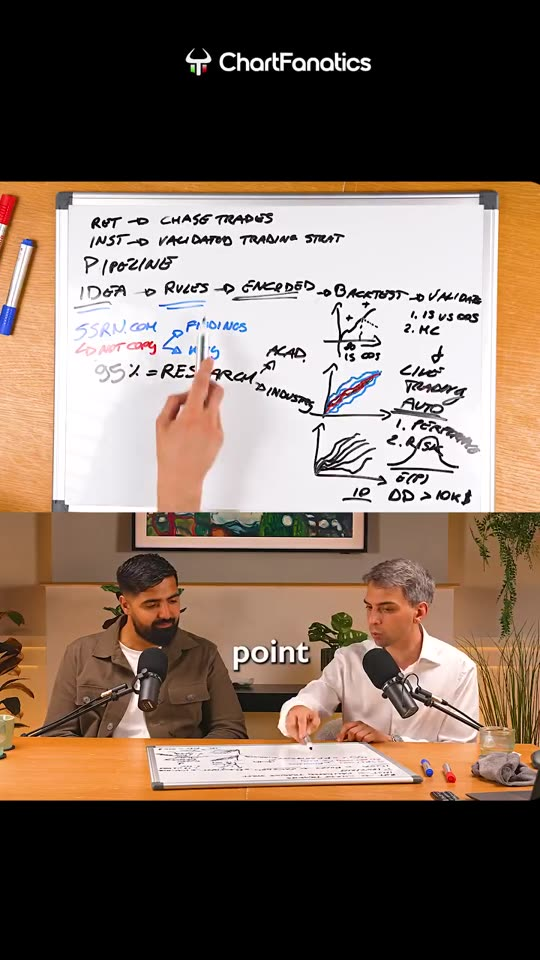

# Reel by Chart Fanatics

- **URL:** https://www.instagram.com/reel/Dd4QRzpFM00/?dlrf=N2xwYmNta2lkaXdr
- **Shared:** 2026-10-17 14:31 UTC
- **Duration:** 46s
- **Spoken language:** en

## Caption

THIS Made Him BILLIONS (MUST WATCH)🚨
 
Follow @chartfanatics to master trading🔥

## Transcript

[0:00] steal this, like steal as much as you can because 90% of institutional trading strategies are
[0:05] coming from this one place. The place is the social science research network. It's like this
[0:11] giant collection of all this research where anyone can just go dig and try to find something
[0:17] interesting. And in particular, like there is two types of research. There is academic research
[0:22] and the industry, which might be hedge fund managers or traders conduct some specific
[0:28] research around trading strategies and they publish them online. You can understand what
[0:32] is this research about, what are the findings, why is it supposed to make money. You don't copy
[0:36] the research one to one, but it is an extremely important starting point to define your trading
[0:42] strategies rules. And if you keep digging, you'll find gold.

## Frames

 at 1s
 at 3s
 at 5s
 at 7.1s
 at 9.1s
 at 11.1s
 at 13.1s
 at 15.1s
 at 17.1s
 at 19.1s
 at 21.2s
 at 23.2s
 at 25.2s
 at 27.2s
 at 29.2s
 at 31.2s
 at 33.3s
 at 35.3s
 at 37.3s
 at 39.3s
 at 41.3s
 at 43.3s
 at 45.3s
