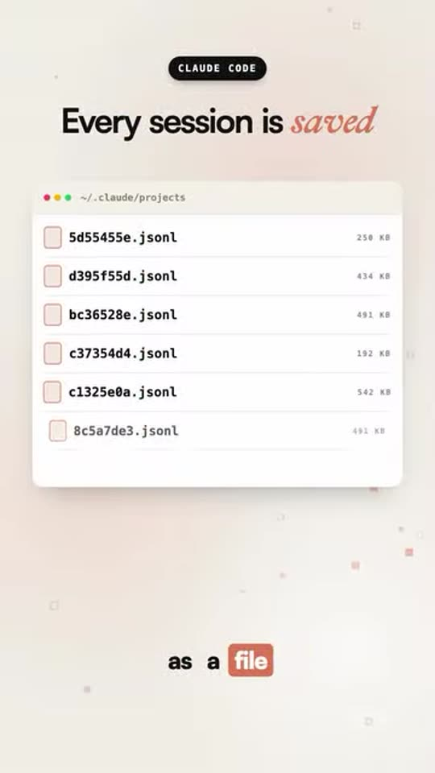
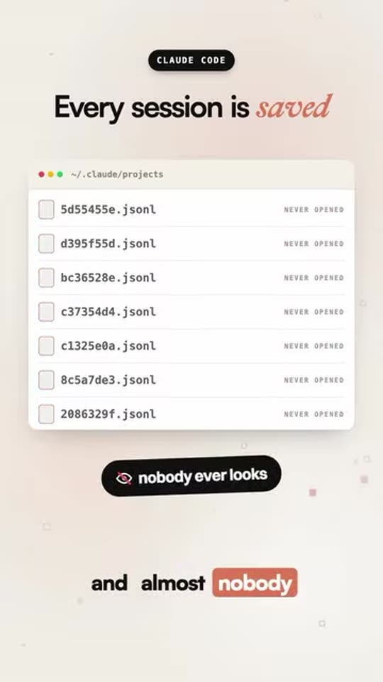
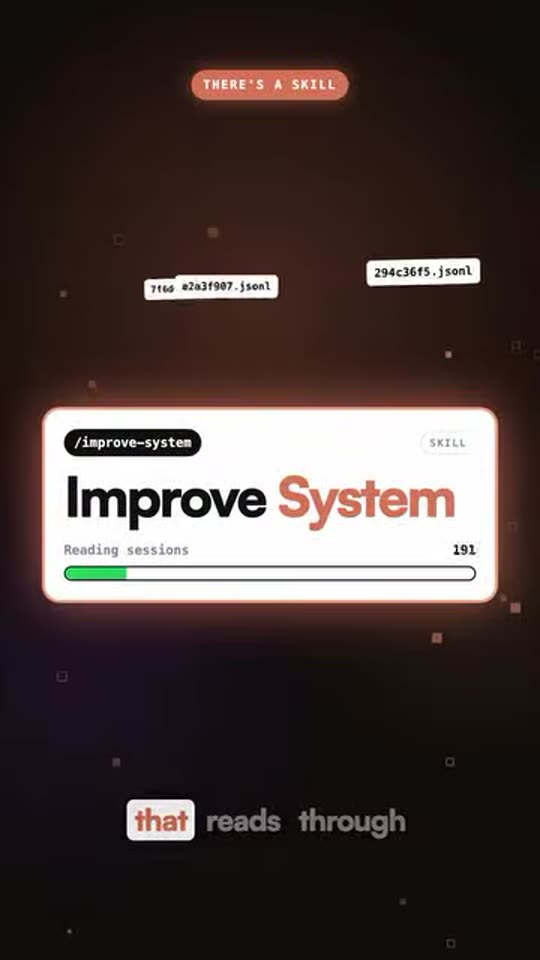
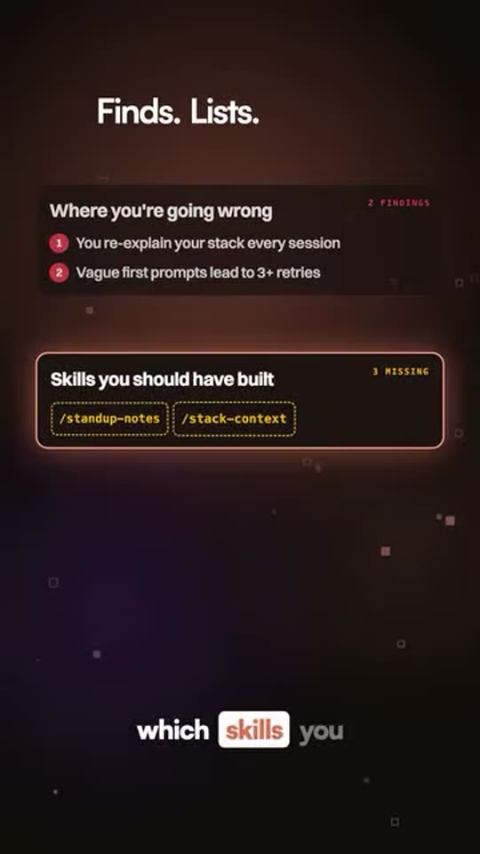
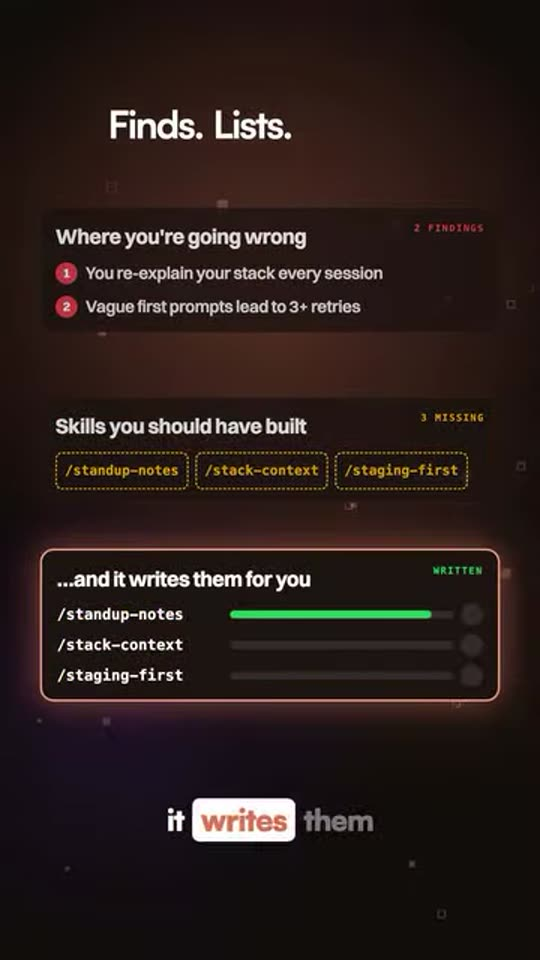
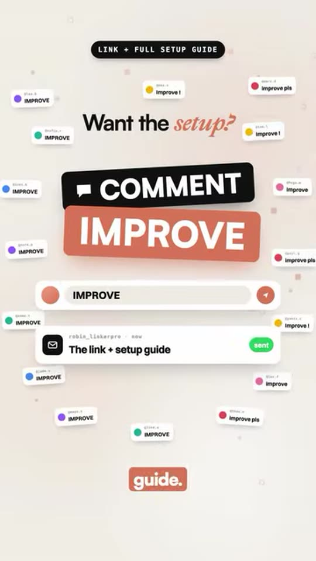

# Reel by Robin TEMPE

- **URL:** https://www.instagram.com/reel/DejzTLZtGiA/?cplk=cmU5MHV4b3h4ZTBu
- **Shared:** 2026-10-17 04:07 UTC
- **Duration:** 48s
- **Spoken language:** en

## Caption

Comment « IMPROVE » and I’ll send you the link and a full setup guide.

You can now get Claude to improve itself by reading back through your conversations with it. One command.

Every Claude Code session is saved on your computer, and almost nobody looks at it. That history is everything Claude got wrong, everything you had to explain twice, and every job you keep doing by hand.

The Improve System skill reads it all for you:
→ where you’re going wrong
→ which skills you should already have built (and it writes them)
→ the tasks you repeat every day, and how to automate them

Install the Build Partner plugin inside Claude, run the command, done.

Comment IMPROVE below.

## Transcript

[0:00] You can now get Claude to improve itself by reading back through every conversation you've ever had
[0:04] with it, and it literally takes one command. Every session you run in Claude Code is saved
[0:08] as a file on your computer, and almost nobody ever looks at it. That history is a record of
[0:12] everything Claude has got wrong and everything you've had to explain twice. It's also every
[0:17] job that you keep doing by hand. So instead of sitting there trying to think which skills to
[0:20] build, there's a skill called improve system that reads through everything for you. It tells
[0:24] you where you're going wrong, it tells you which skills you should already have built,
[0:28] and then it writes them for you. And what's even more insane is that it flags the things that you
[0:32] keep doing every day and spending hours on. Then it shows you how to automate them,
[0:35] so they're done in minutes. To set it up, you install the build partner plug-in inside
[0:40] Claude, and from there you just run slash self-improve system. If you comment improve,
[0:44] I'll send you the link and a full setup guide.

## Frames

 at 1s
 at 3s
 at 5s
 at 7s
 at 9s
 at 10.9s
 at 12.9s
 at 14.9s
 at 16.9s
 at 18.9s
 at 20.9s
 at 22.9s
 at 24.9s
 at 26.9s
 at 28.9s
 at 30.8s
 at 32.8s
 at 34.8s
 at 36.8s
 at 38.8s
 at 40.8s
 at 42.8s
 at 44.8s
 at 46.8s
