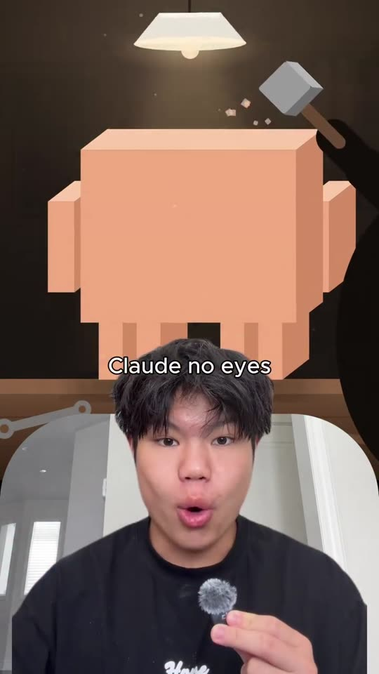
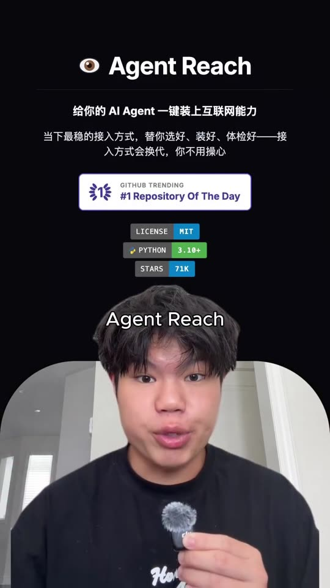
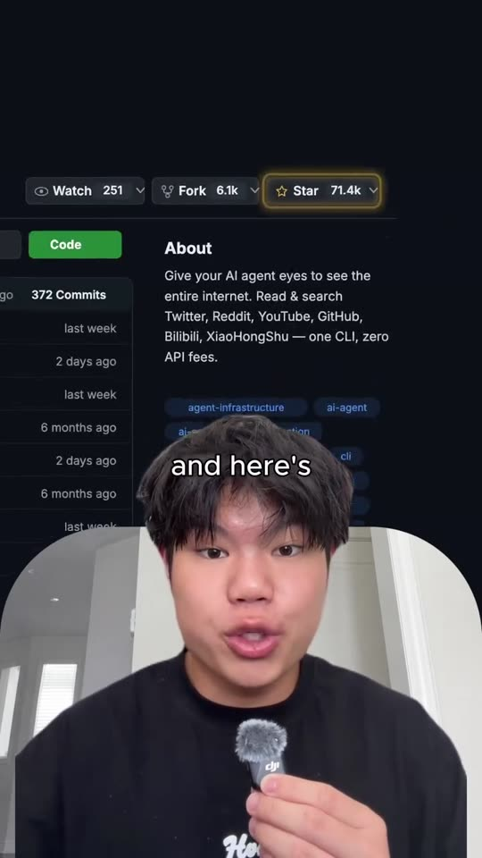
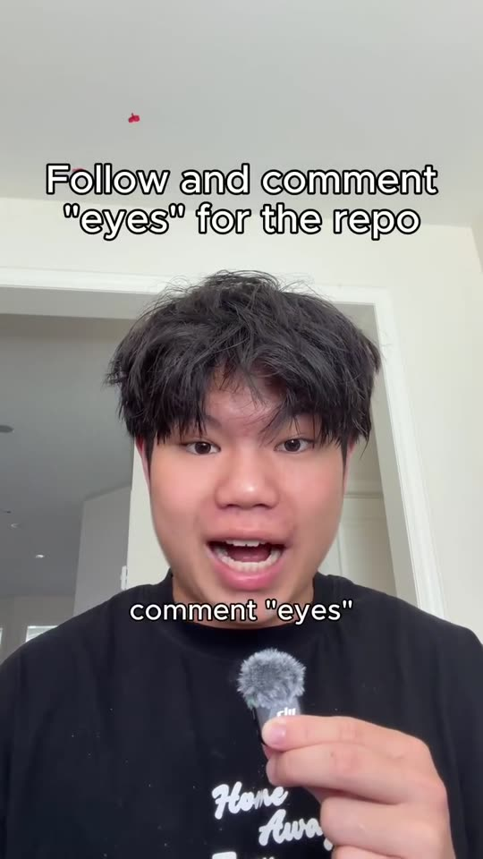

# Reel by Ryan Ip

- **URL:** https://www.instagram.com/reel/Db_7HChtxFW/?exln=MXhwNHNwcGM2MWlzcA==
- **Shared:** 2026-10-18 15:27 UTC
- **Duration:** 23s
- **Spoken language:** en

## Caption

Follow and comment “eyes” for the GitHub repo!

## Transcript

[0:00] Anthropic gave Claude no eyes but this repo fixes it.
[0:02] It's called Age of Reach and it gives Claude the ability
[0:04] to read the internet live.
[0:05] It's already at 71,000 stars and here's what it solves.
[0:08] Many platforms lock their information
[0:09] behind a login wall, a rate limit, or a $500 API key.
[0:12] But with this repo, you can access 17
[0:13] of the biggest platforms all for free.
[0:15] You can now scrape leads on LinkedIn,
[0:16] analyze YouTube videos, stalk viral ex posts,
[0:19] or see what's trending on Instagram.
[0:20] If you wanna try it yourself,
[0:21] follow and comment eyes and I'll send the repo.

## Frames

 at 1s
 at 3.1s
 at 5.2s
 at 7.3s
 at 9.4s
 at 11.5s
 at 13.6s
 at 15.7s
 at 17.7s
 at 19.8s
 at 21.9s
