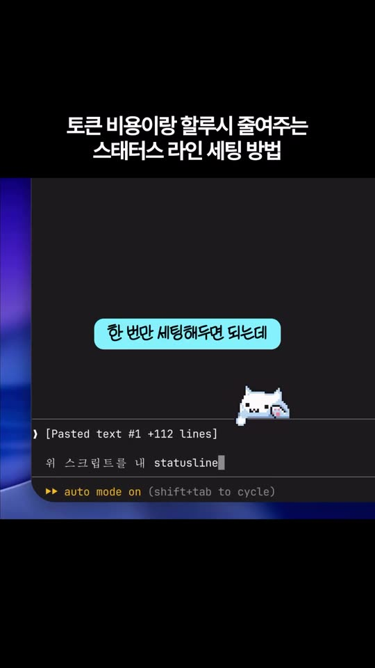
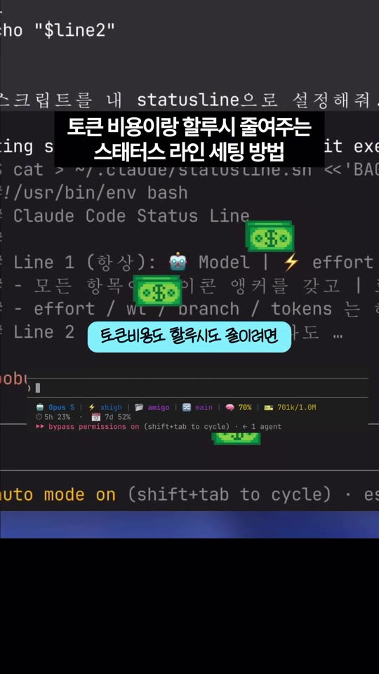
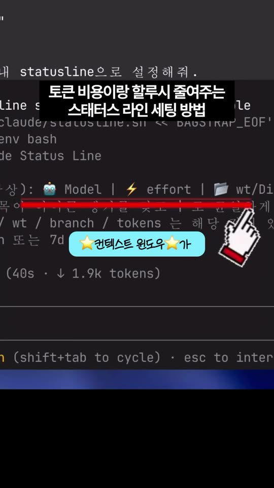
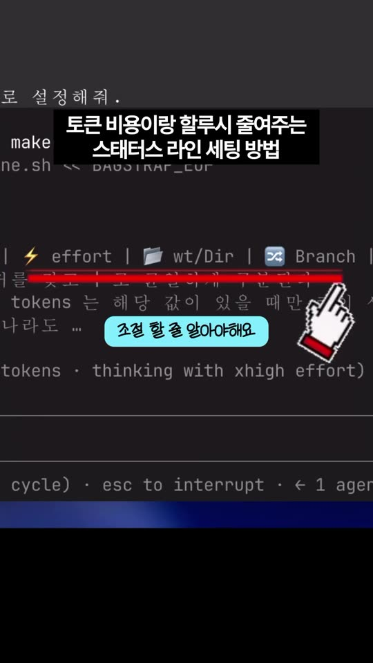
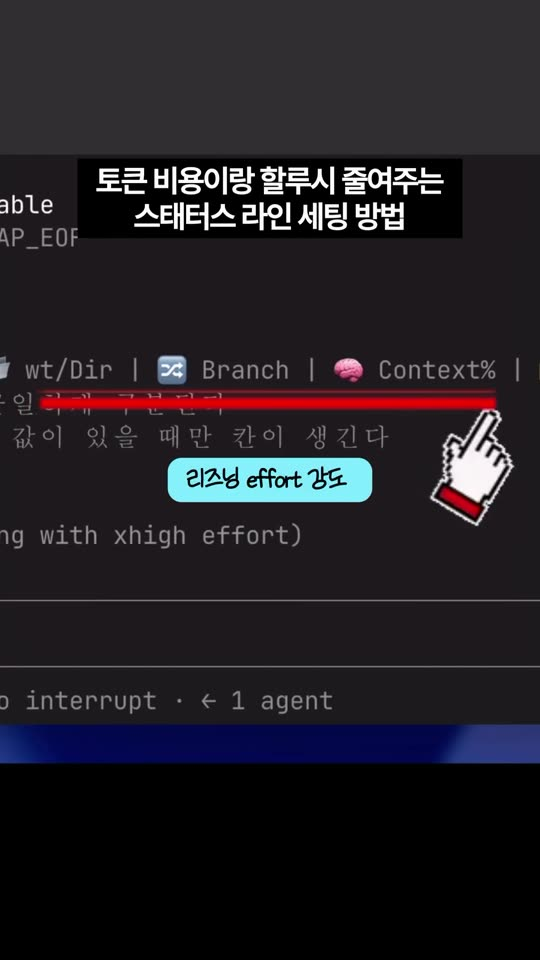
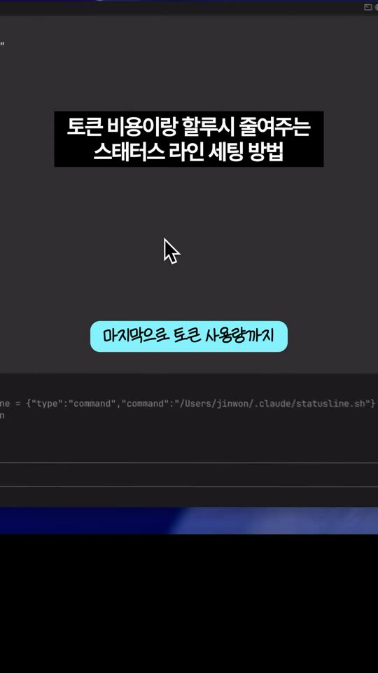
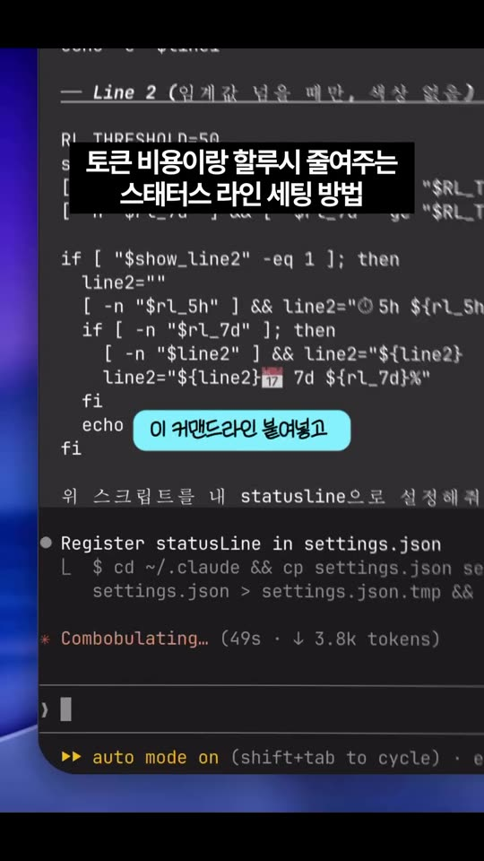
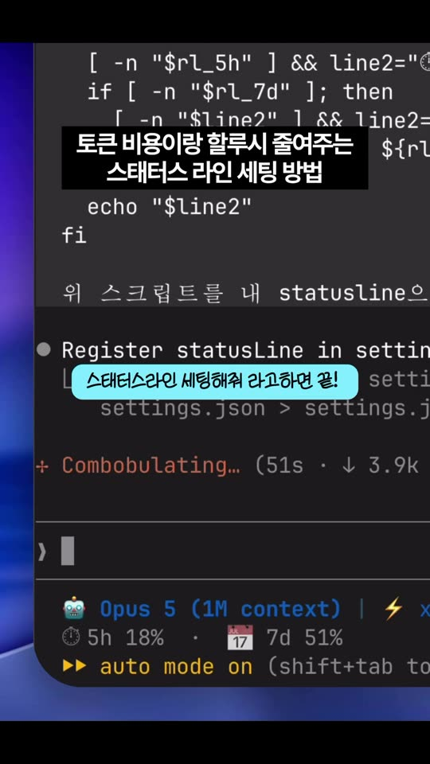
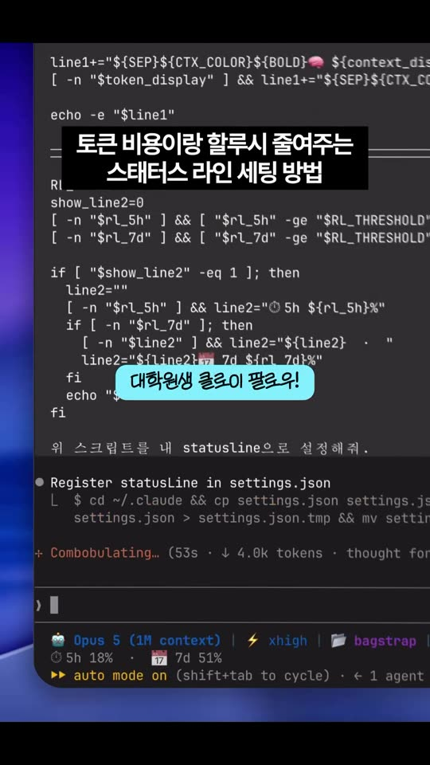

# Reel by 대학원생 클로이 | 논문 ∗ 대학원 ∗ AI

- **URL:** https://www.instagram.com/reel/DcOKEqAhWM0/?dlrf=MWZhYnlnbDhqdGVxMw==
- **Shared:** 2026-10-18 15:22 UTC
- **Duration:** 23s
- **Spoken language:** ko

## Caption

[댓글에 클로드]📌한 번만 세팅해두면 되는데 1분도 안걸림!
바로 Status line 설정이에요

💸토큰비용도 🌀할루시도 줄이려면
⚡️컨텍스트 윈도우가 
🔋얼마나 찼는지를 본인이 알고 
📊조절 할 줄 알아야해요

- 어떤 모델을 쓰는지 
- 리즈닝 effort 강도 
- 작업 폴더와 
- 컨텍스트 윈도우 
- 마지막으로 토큰 사용량까지

늘 띄워두고 모니터링 할 수 있는
이 커맨드라인 붙여넣고 
스태터스라인 세팅해줘 라고하면 끝! 

📌더 많은 #클로드 꿀팁은💌
🩵대학원생 클로이 @chloe_et_al 팔로우!

#대학원생 #대학원 #논문 #클로드코드

## Transcript

[0:00] 클로드코드!
[0:00] 이 세팅 안 할 거면 쓰지도 마세요!
[0:02] 한 번만 세팅해두면 되는데
[0:04] 1분도 안 걸린 바로 스테투스 라인 설정이에요
[0:06] 토큼비용도 한루시도 줄이려면
[0:07] 컨텍스트 윈도우가 얼마나 찾는지를 본인이 알고
[0:10] 조절할 줄 알아야 해요
[0:11] 어떤 모델을 쓰는지
[0:12] 비즈닝 애플 강도
[0:13] 작업 폴더와 컨텍스트 윈도우
[0:15] 마지막으로 토큰 사용량까지
[0:16] 늘 띄워두고 모니터링 할 수 있는
[0:18] 커맨드라인 붙여놓고
[0:19] 스테투스 라인 세팅해줘라고 하면
[0:20] 끝! 더 많은 클로드 꿀팁은
[0:21] 대학원생 클로이 팔로우

## Frames

 at 1s
 at 2.9s
 at 4.8s
 at 6.7s
 at 8.6s
 at 10.5s
 at 12.5s
 at 14.4s
 at 16.3s
 at 18.2s
 at 20.1s
 at 22s
