# Reel by Hyperautomation Labs

- **URL:** https://www.instagram.com/reel/Demo6mdgilA/?dlrf=MWRkaXdoZ3J4dm1rNg==
- **Shared:** 2026-10-18 06:46 UTC
- **Duration:** 28s
- **Spoken language:** en

## Caption

Oracle gives you 3 servers, 2 databases and 10 TB. Free. Forever.
One Arm server with 2 CPUs and 12 GB of RAM (enough for your own AI model), two small AMD servers, two databases at 20 GB each, and 10 TB of traffic out every month. The catch: a card to sign up. Oracle says it is not charged unless you upgrade.

💬 Comment "TRIPLE" and I'll DM you the free setup card

Save this 🔖 Follow @hyperautomationlabs for daily AI builds

#oraclecloud #selfhosted #freeserver #homelab #localai

## Transcript

[0:00] Oracle gives you three servers, two databases, 10 terabytes free forever.
[0:05] Server one, two CPUs, 12 gigs of RAM, big enough to run your own AI model.
[0:10] Servers two and three, small AMD boxes, your website, your bots.
[0:14] Two databases, 20 gigs each, nothing to install.
[0:17] 10 terabytes of traffic out, every single month.
[0:20] The catch? A card to sign up.
[0:22] It is not charged unless you upgrade.
[0:24] Comment triple and I'll send you the setup card. Save this.

## Frames

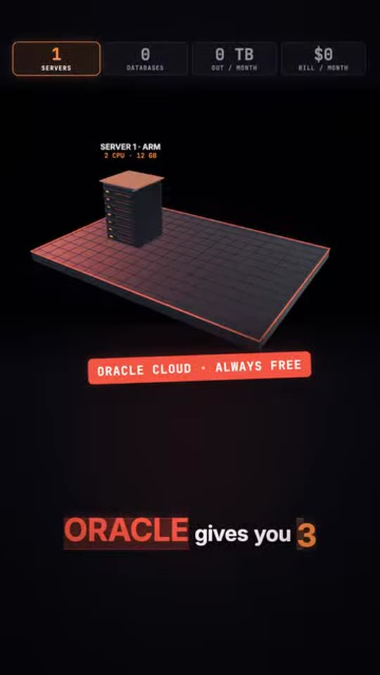 at 1s
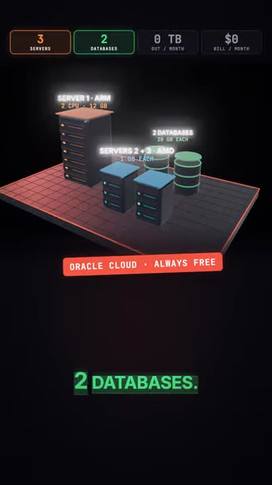 at 3s
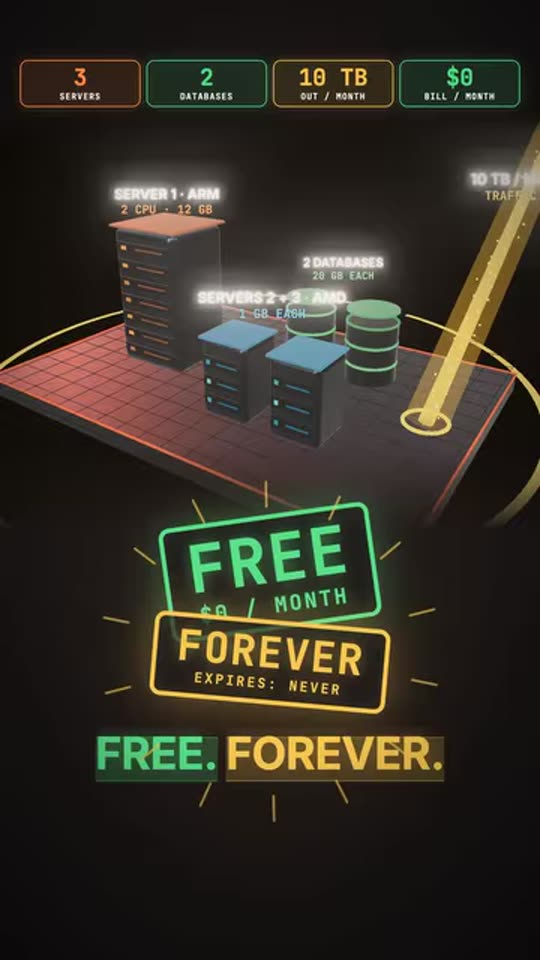 at 5s
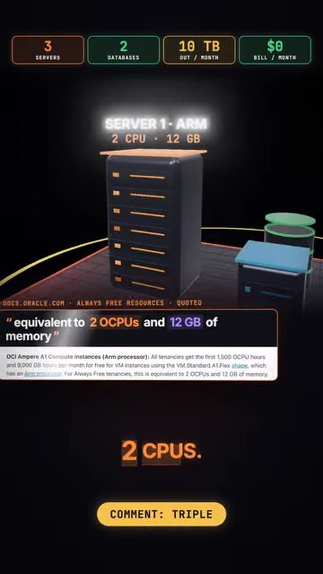 at 7s
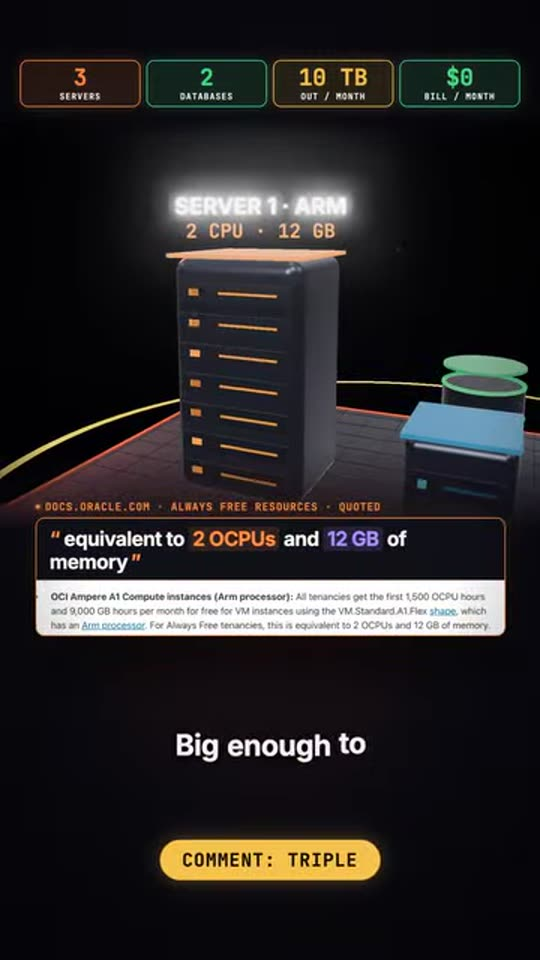 at 9.1s
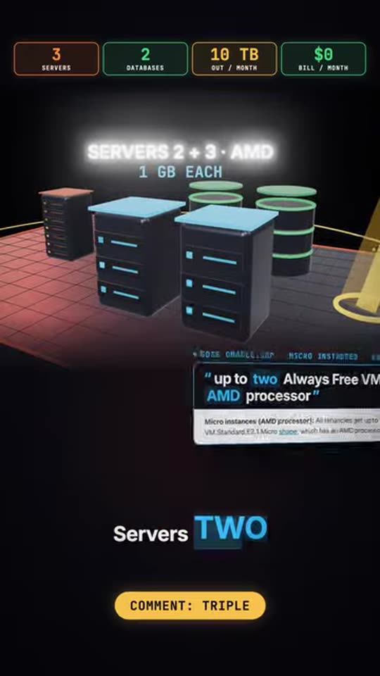 at 11.1s
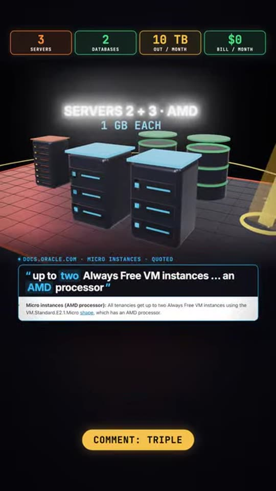 at 13.1s
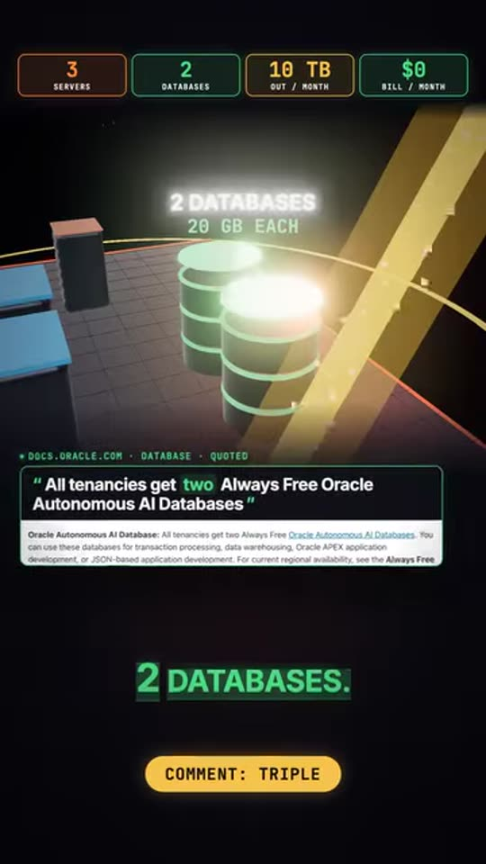 at 15.1s
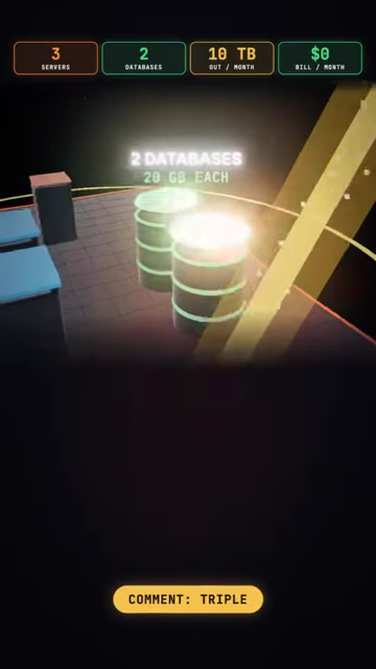 at 17.1s
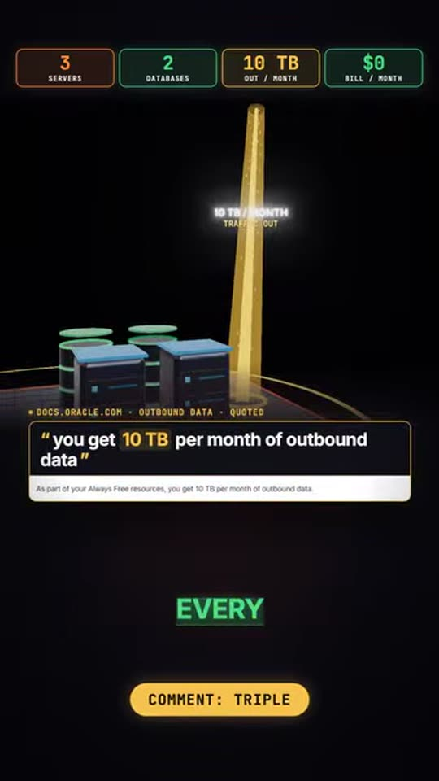 at 19.1s
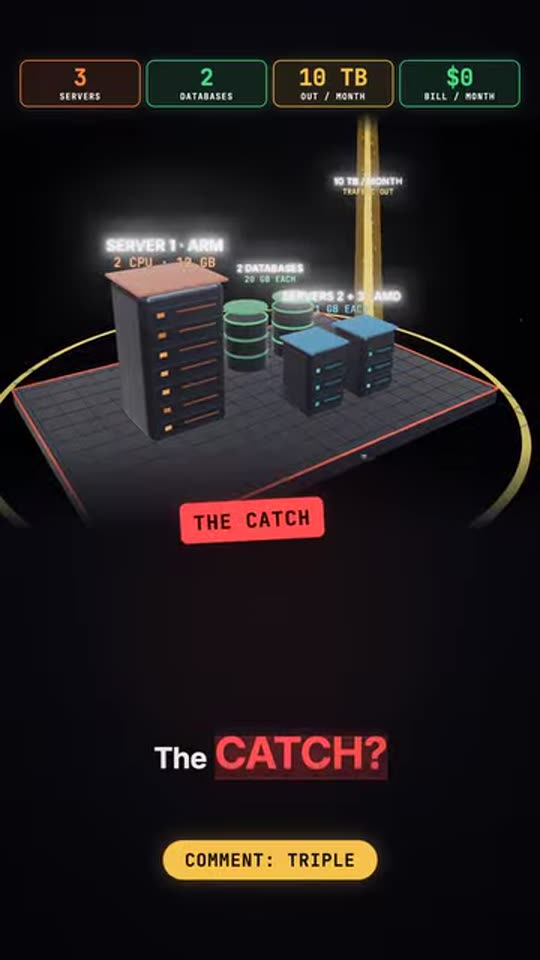 at 21.1s
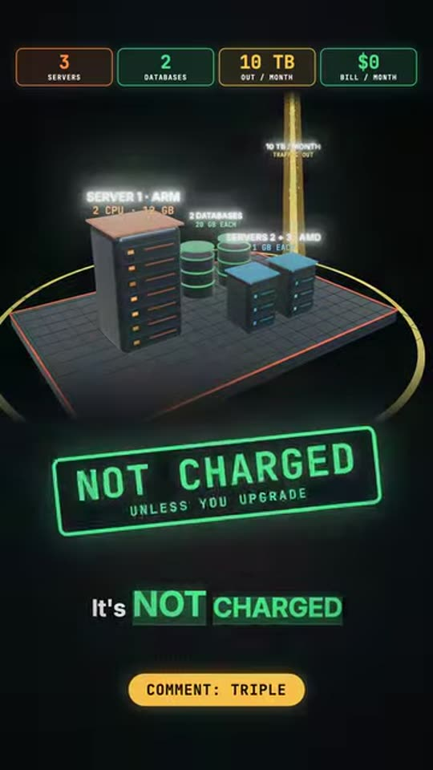 at 23.1s
 at 25.2s
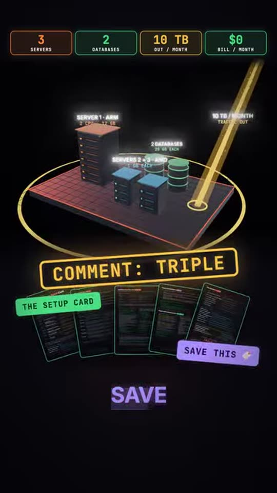 at 27.2s
