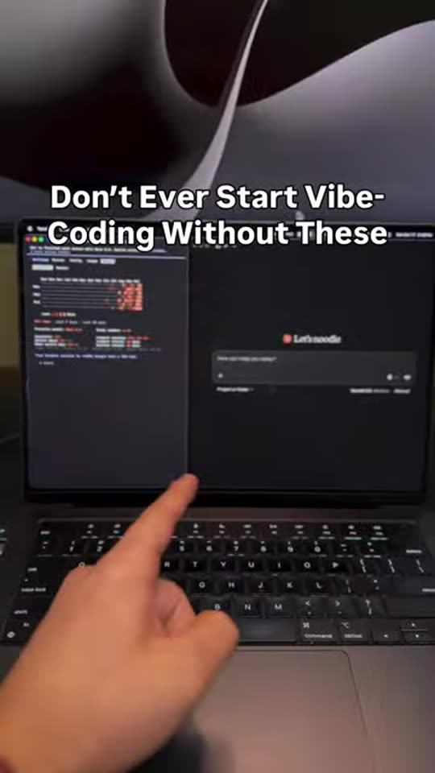
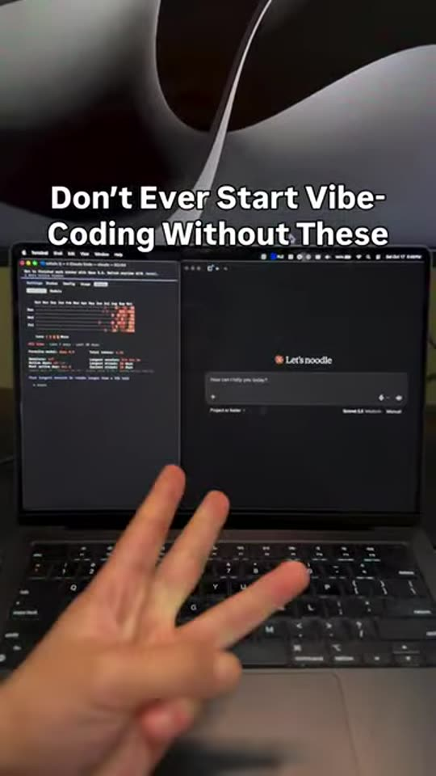
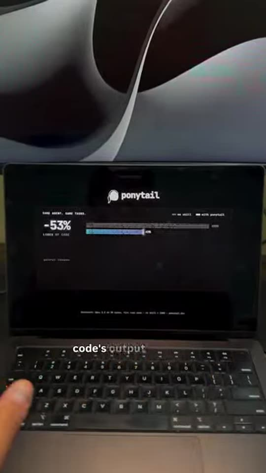
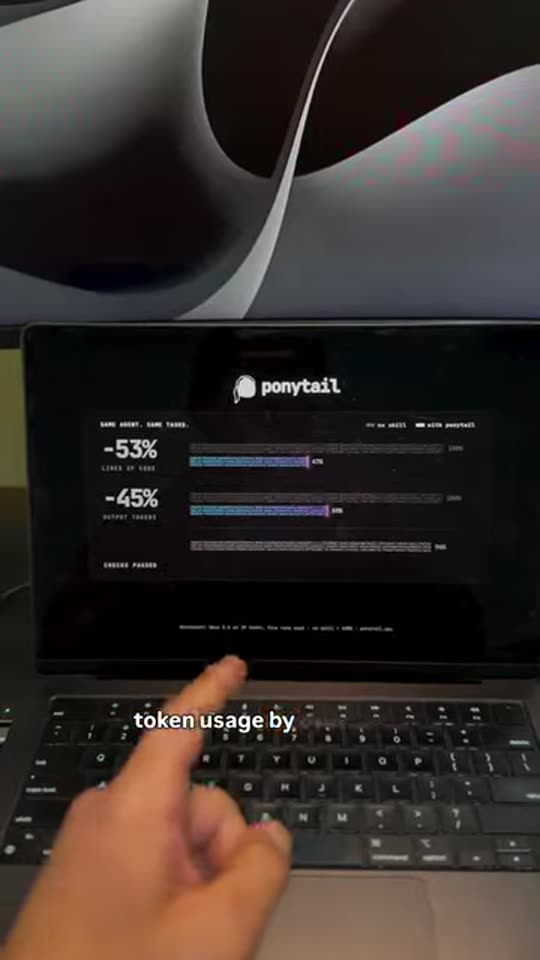
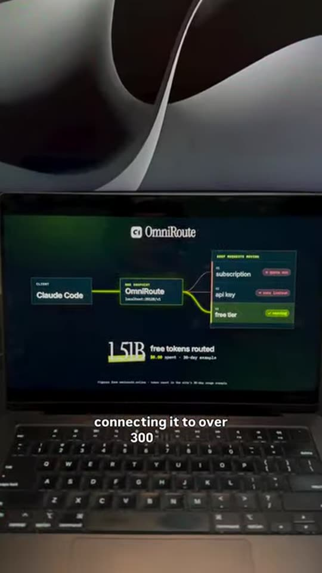
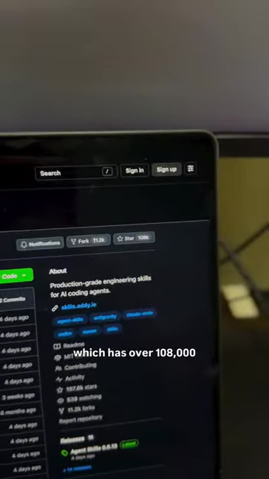
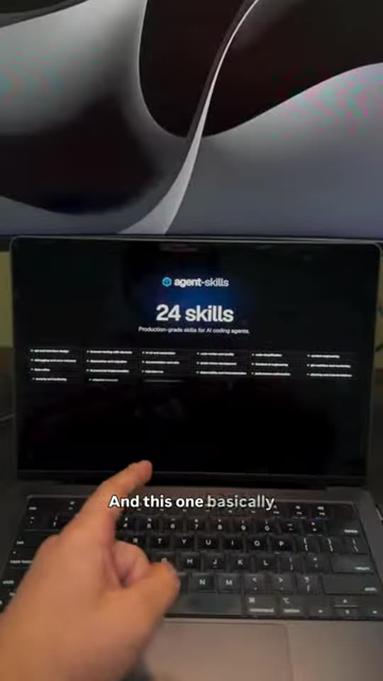
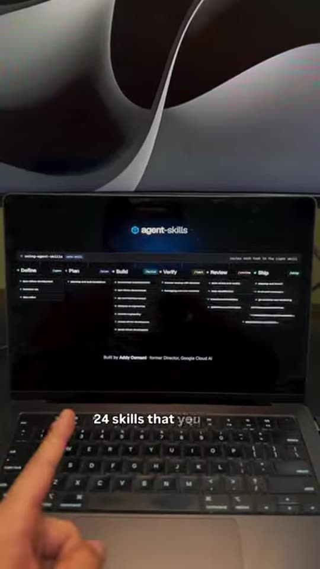

# Reel by Sahain Taneja

- **URL:** https://www.instagram.com/reel/DenaVzhO0L-/?cplk=NG53aWl4cHBkZGgz
- **Shared:** 2026-10-18 13:59 UTC
- **Duration:** 53s
- **Spoken language:** en

## Caption

Comment “CODING” to get all of these plugins plus 1 secret one to level up your vibe coding completely 

#money #business #ai

## Transcript

[0:00] Do not ever start vibe coding without these three key plugins.
[0:04] The first one, ponytail.
[0:06] It basically optimizes clod code's output and cuts your token usage by over 50%.
[0:12] The second one, OmniRoot, which has over 77,000 stars.
[0:17] And it basically gives clod code almost unlimited usage by connecting it to over 300 other
[0:22] free AI providers.
[0:24] So once your clod code hits your usage, it'll automatically switch you to the next
[0:28] best model.
[0:29] And the third one, agent skills, which has over 108,000 stars.
[0:34] This one basically has over 24 skills that you can vibe code like a real senior engineer.
[0:39] It has dedicated skills for planning, coding, testing, and publishing, and it activates
[0:44] the right one at the specific status of coding.
[0:47] So if you want access to all of these plus a secret one, comment the word coding and
[0:52] I'll send it over to you.

## Frames

 at 1s
 at 3s
 at 4.9s
 at 6.9s
 at 8.9s
 at 10.9s
 at 12.8s
 at 14.8s
 at 16.8s
 at 18.8s
 at 20.7s
 at 22.7s
 at 24.7s
 at 26.7s
 at 28.6s
 at 30.6s
 at 32.6s
 at 34.6s
 at 36.5s
 at 38.5s
 at 40.5s
 at 42.5s
 at 44.4s
 at 46.4s
 at 48.4s
 at 50.4s
 at 52.4s
