# Reel by Abu Huzefa

- **URL:** https://www.instagram.com/reel/Der2L0-T376/?rpxt=ZjR3MzZzZ3BlaG8w
- **Shared:** 2026-10-20 15:45 UTC
- **Duration:** 72s
- **Spoken language:** en

## Caption

The Only Claude Skill You’ll Ever Need

Still digging through GitHub for Claude skills and installing them one by one? find-skills does the hunting for you.

Tell it what you're working on, whether that's content, design, or code, and it searches the skills directory for the best matches.

It checks each skill's install count and who made it.

Once you approve one, it installs it straight into your setup.

It has almost 4 million installs and ranks as the 1 skill on the directory.

If you're into Claude, Claude Code, AI agents, or AI productivity, save this post!

Comment "SKILLS" below, and I'll DM you the skill.

[keywords: Claude, Claude AI, Claude Code, Claude skills, find-skills, Claude Code skills, agent skills, skills directory, skills sh, install Claude skills, best Claude skills, Claude plugins, Claude tips, Anthropic, Anthropic Claude, Claude Opus, Claude Sonnet, Claude Haiku, AI agents, AI coding, AI programming, AI developer tools, AI automation, AI productivity, AI workflow, vibe coding, coding, programming, content creation, AI design, MCP servers, subagents, ChatGPT, OpenAI, Codex, Gemini, Cursor, GitHub Copilot, DeepSeek, Grok, LLM, large language models, generative AI, artificial intelligence, AI tools, free AI tools, GitHub, open source]

#claudeai #claudecode #anthropic #aitools #aiagents

## Transcript

[0:00] If you're using Claude and not using this one skill, then you are using Claude wrong.
[0:05] So what is it?
[0:07] Well, it's called Find Skills, and what it does is find and install other skills for
[0:12] you.
[0:13] Now, many of you are wondering why you need this, because there are about 1.4 million
[0:18] Claude skills out there right now.
[0:20] And if you're out here digging through GitHub and websites, copying links and installing
[0:25] them one by one in 2026, then you're living in the Stone Age, bro.
[0:30] It's time to act smart, not dumb.
[0:33] So how does it work?
[0:34] Well, you just install this one skill and you tell it what you're working on,
[0:38] whether that's content, design, or code.
[0:41] It searches the entire skills directory and finds the skills that suit your project
[0:45] best.
[0:46] Then, it checks how many people installed each one and who exactly made it.
[0:51] And once you approve the one you want, it installs it straight into your setup.
[0:55] And it already has almost 4 million installs, and it's ranked as the number
[0:59] one skill on the whole directory.
[1:02] So stop installing skills manually, bro.
[1:05] Nobody is giving you extra Claude credits for doing it the hard way.
[1:08] If you want this skill, just comment the word skills and I'll send it to you.

## Frames

 at 1s
 at 3s
 at 5s
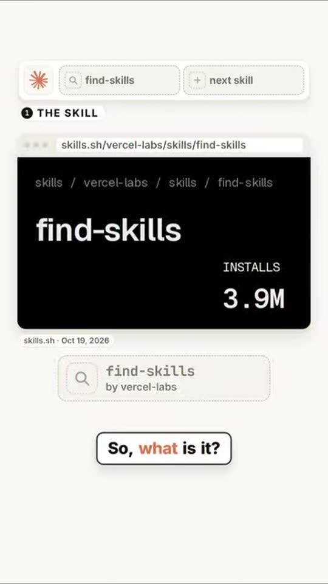 at 7s
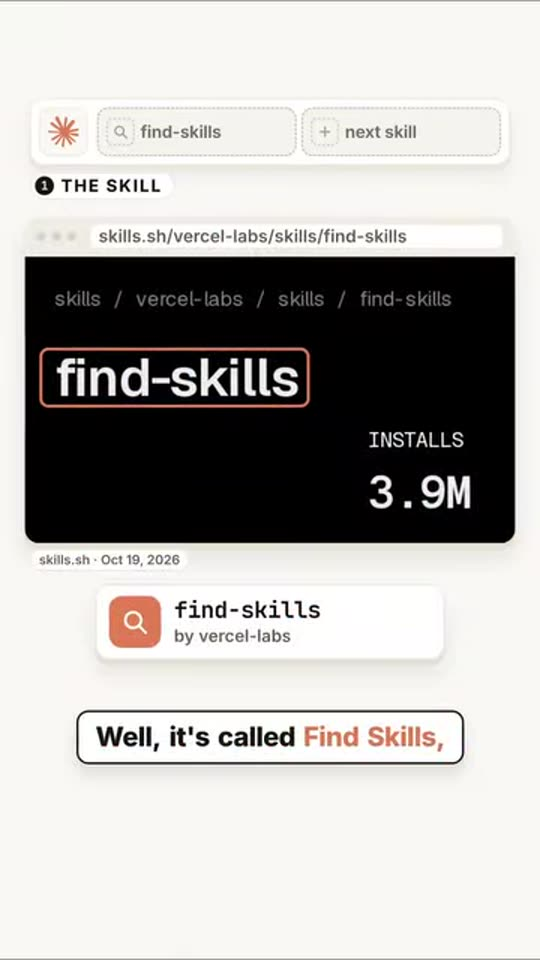 at 9.1s
 at 11.1s
 at 13.1s
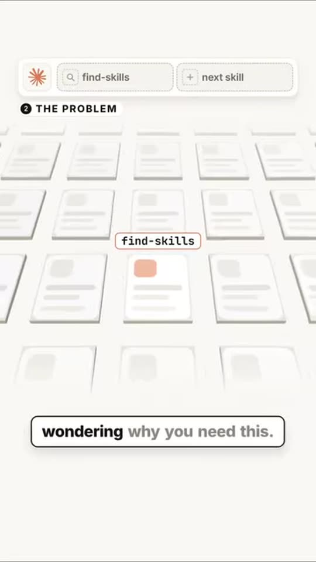 at 15.1s
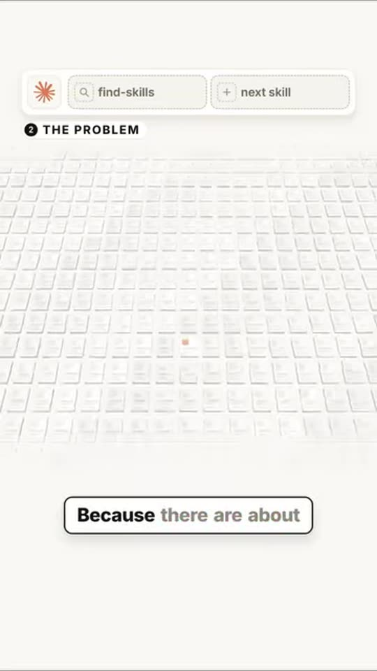 at 17.1s
 at 19.1s
 at 21.1s
 at 23.2s
 at 25.2s
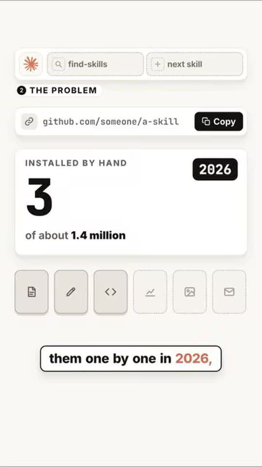 at 27.2s
 at 29.2s
 at 31.2s
 at 33.2s
 at 35.2s
 at 37.2s
 at 39.3s
 at 41.3s
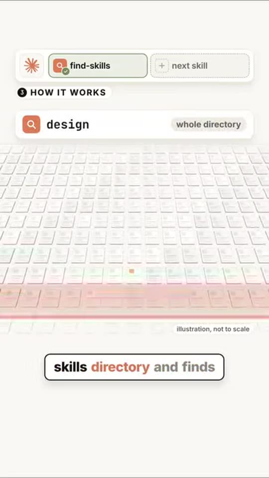 at 43.3s
 at 45.3s
 at 47.3s
 at 49.3s
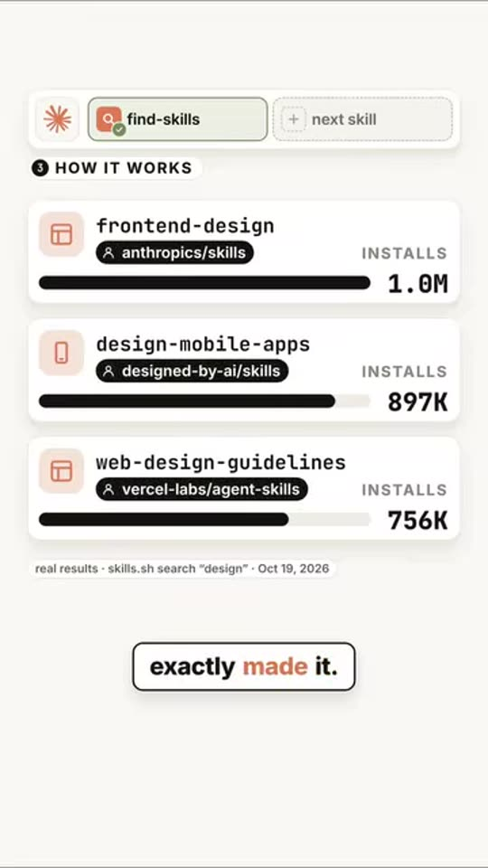 at 51.3s
 at 53.3s
 at 55.4s
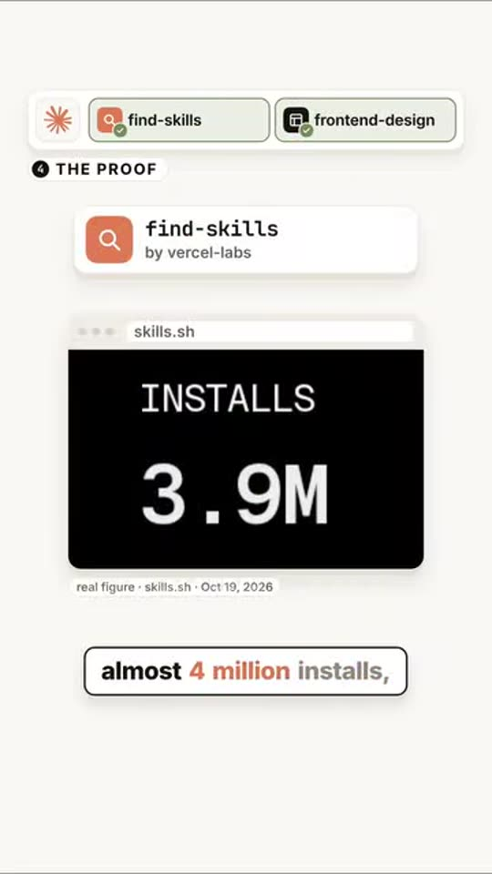 at 57.4s
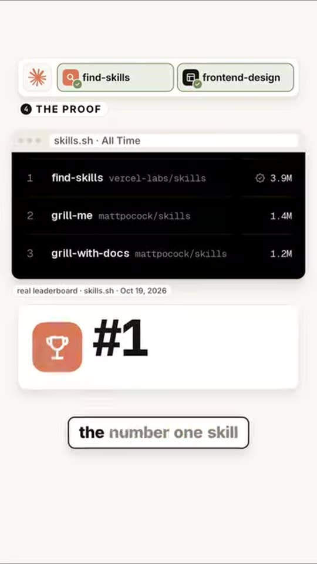 at 59.4s
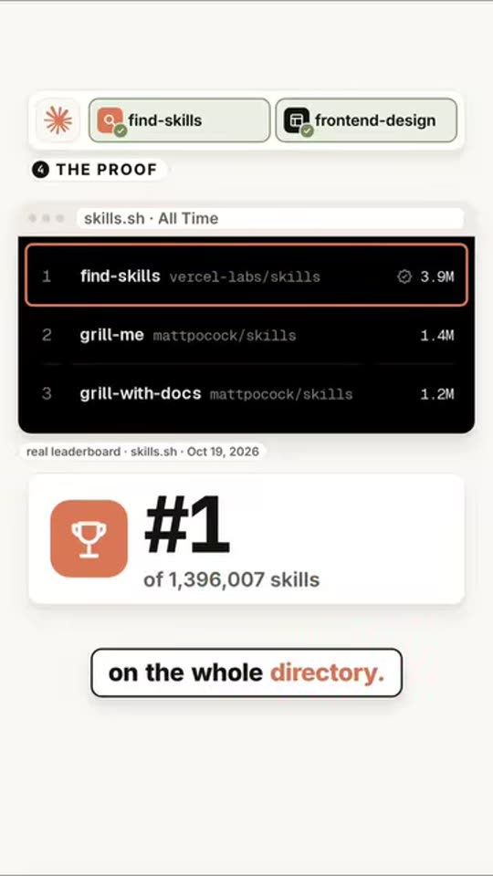 at 61.4s
 at 63.4s
 at 65.4s
 at 67.4s
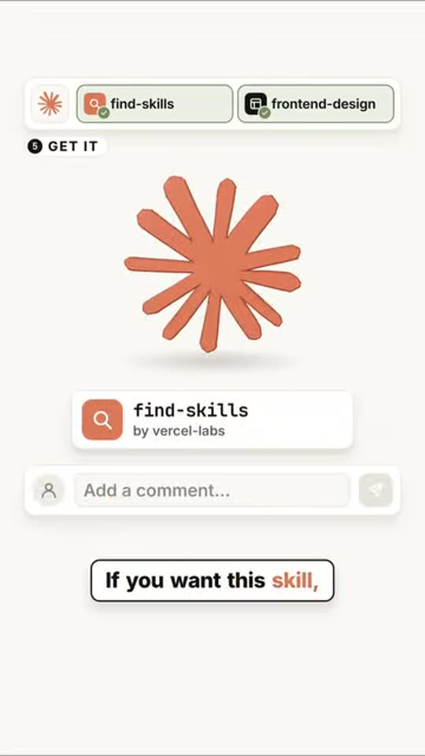 at 69.5s
 at 71.5s
