# Reel by Wassim Younes

- **URL:** https://www.instagram.com/reel/DeuDCTFRJmB/?psln=MWppNno5c3Ftamc0Zw==
- **Shared:** 2026-10-20 15:30 UTC
- **Duration:** 35s
- **Spoken language:** en

## Caption

Comment “DEEPSEEK” and I’ll send you the DeepInfer repo. ⚡

DeepSeek has open-sourced the inference framework behind its large-scale production services.

Called DeepInfer, it provides tools for running DeepSeek AI models efficiently, with the public release currently supporting DeepSeek-V4.1-Flash. It includes optimized GPU kernels, parallel processing and decoding techniques designed to accelerate text generation. (github.com)

🧠 Faster decoding using draft tokens and verification
⚙️ Scheduling that overlaps CPU work with accelerator execution
📋 Structured outputs using JSON schemas and other formats
🔓 Apache 2.0 open-source license

For AI developers and infrastructure teams, the release offers a look at how DeepSeek runs models at scale—and tools to build on that work.

The current release focuses on offline inference and supports NVIDIA SM100 GPUs and Huawei Ascend 950 NPUs. A complete production service requires additional components. (github.com)

#DeepSeek #OpenSourceAI #AIInference

## Transcript

[0:00] Massive news guys DeepSeek is releasing their internal engine, essentially parallel stacking, offloading, output quality, optimized GPU kernels, even decoding.
[0:09] They officially also open sourced how their token encoding and decoding components align with processing logic behind DeepSeek.
[0:17] Actually every angle of DeepSeek has been officially open sourced, leading to cheaper computing cost and API cost.
[0:24] So comment down below DeepSeek, I'm giving everything over.
[0:26] It's cool knowing that there's companies giving out their backend or how their AI logic actually operates in their output quality, essentially helping your own local AIs.

## Frames

 at 1s
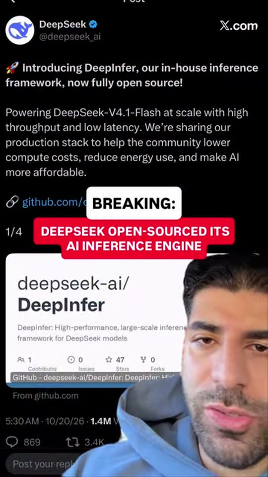 at 2.9s
 at 4.9s
 at 6.8s
 at 8.8s
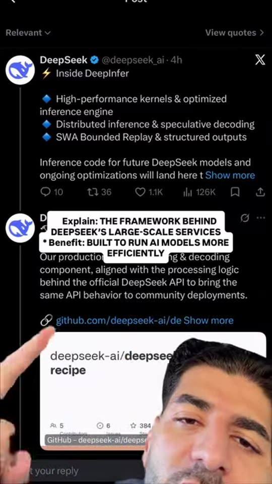 at 10.8s
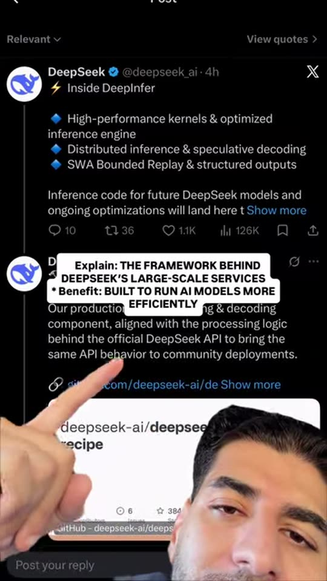 at 12.7s
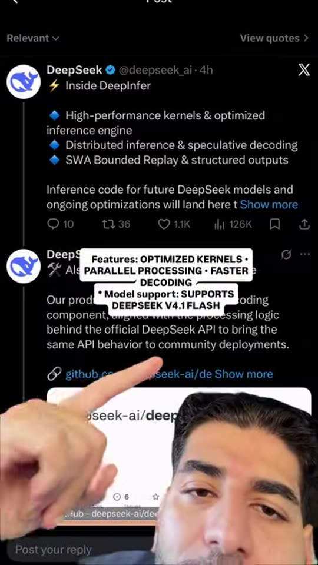 at 14.7s
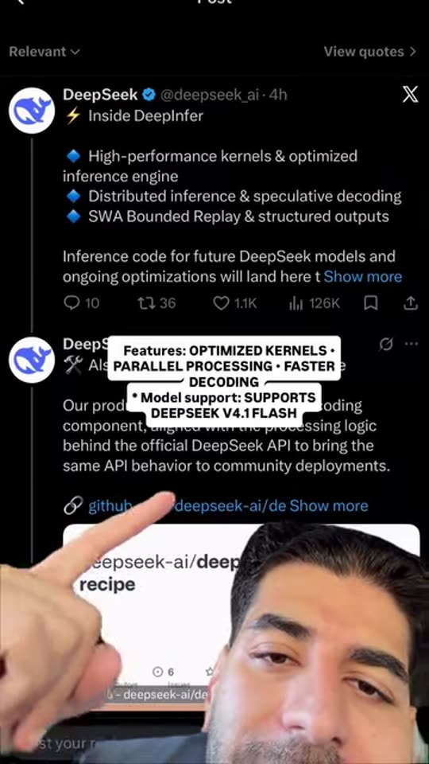 at 16.6s
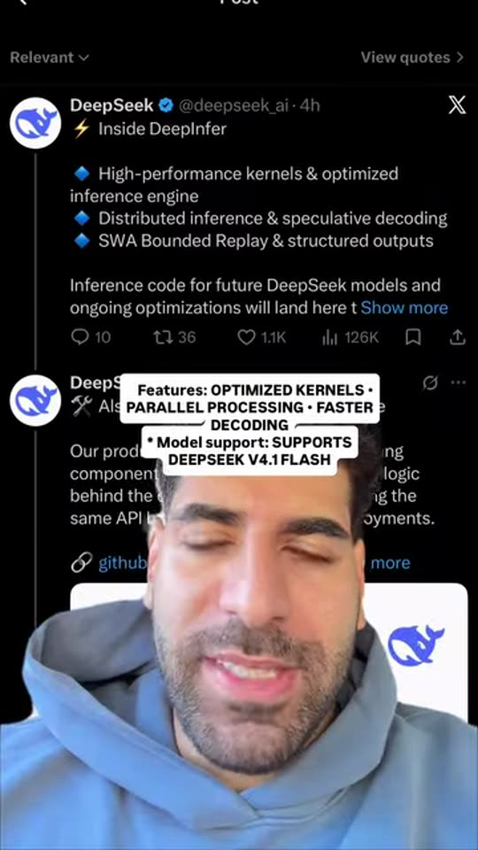 at 18.6s
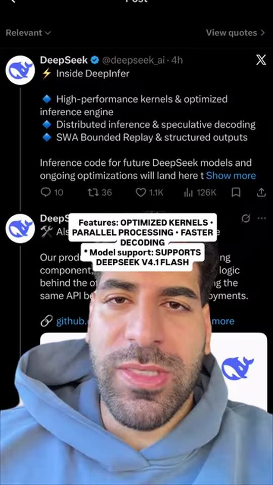 at 20.5s
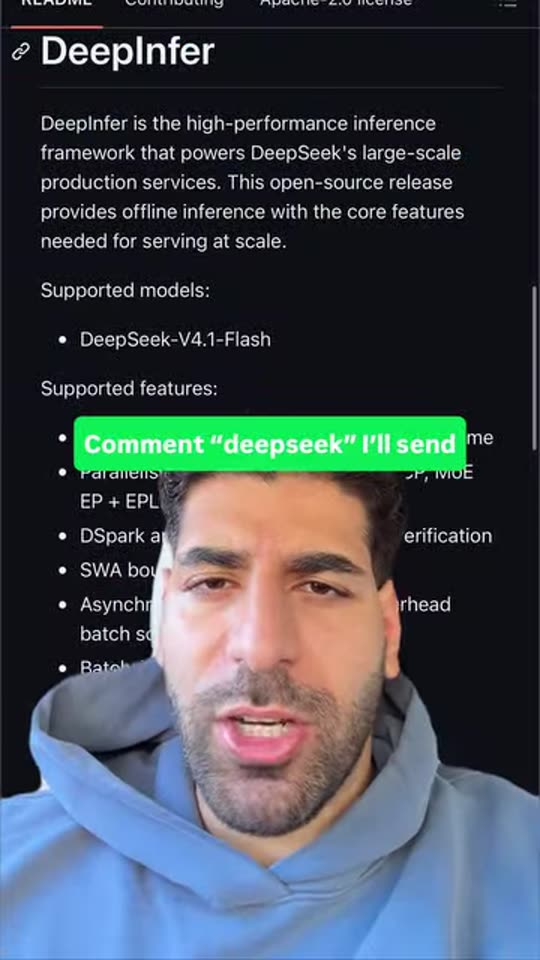 at 22.5s
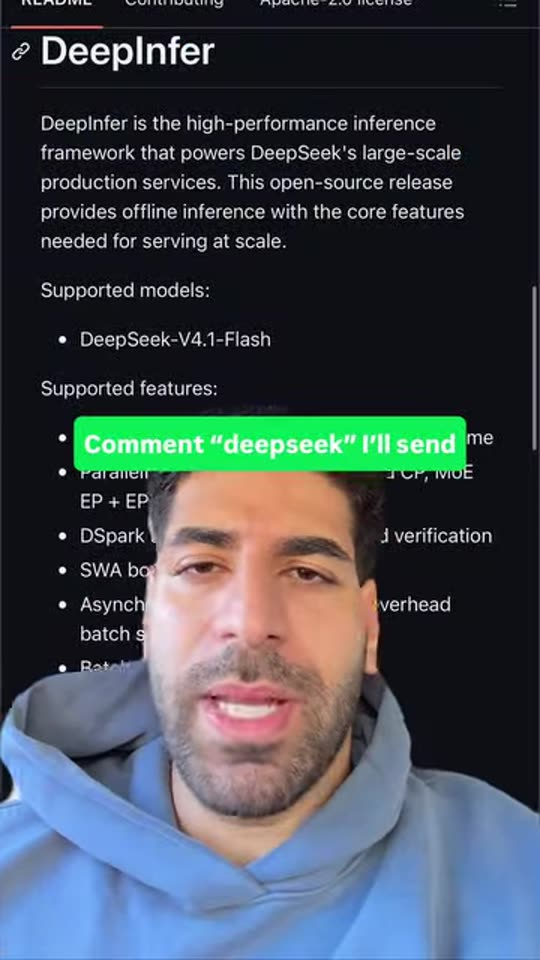 at 24.5s
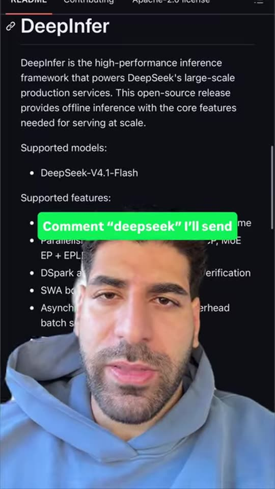 at 26.4s
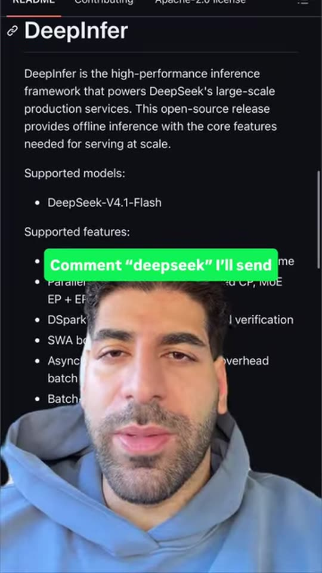 at 28.4s
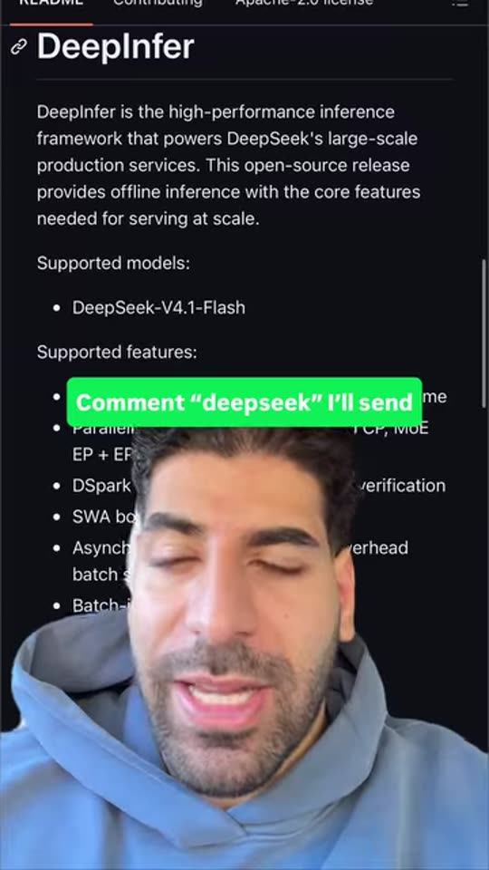 at 30.3s
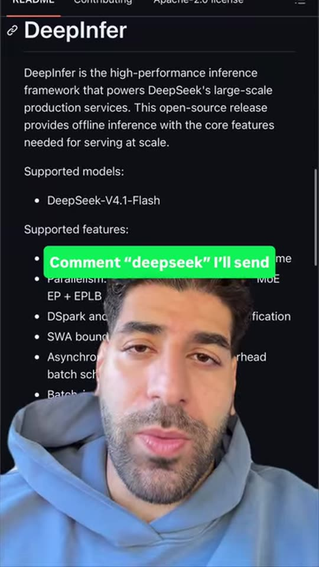 at 32.3s
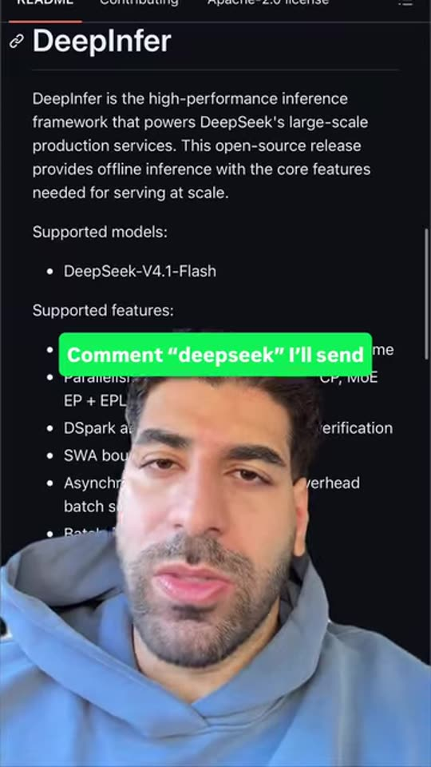 at 34.2s
