# Reel by Bibek yadav

- **URL:** https://www.instagram.com/reel/De-mq1LipqN/?obrf=dWJjeXRkZW9lNzgz
- **Shared:** 2026-10-28 16:28 UTC
- **Duration:** 32s
- **Spoken language:** en

## Caption

LearnHarness is a free, open-source desktop app where AI agents teach you, from what you understand now to your goal.

First it finds where your understanding ends. Then it plans the steps and teaches one at a time: you predict, get an explanation, check yourself. Practice is separate. Everything you learn goes into a knowledge graph that later sessions read.

Chats, graph and keys stay on your machine. It works with 30+ providers including OpenAI, Anthropic, Google and DeepSeek, on Windows, macOS and Linux, under AGPL-3.0.

The catch: you bring your own API key and pay your provider for usage.

Repo: https://github.com/amosblomqvist/learnharness

Save this for the next thing you want to learn.

#ailearning #aiagents #opensource

## Transcript

[0:00] You don't need a tutor to learn something hard.
[0:02] LearnHarness is a free open source app
[0:05] where AI agents teach you
[0:06] from what you know now to your goal.
[0:09] Ask Claude to explain something
[0:10] and you get a wall of text.
[0:12] Not here.
[0:13] First, it measures where your understanding ends.
[0:16] Then it teaches one step at a time
[0:18] and what you learn builds into a knowledge graph
[0:21] that future sessions can read.
[0:22] It works with over 30 providers
[0:24] like OpenAI, Anthropik and Google.
[0:27] The catch?
[0:28] You bring your own API key and pay your provider.
[0:31] Link's in the caption.

## Frames

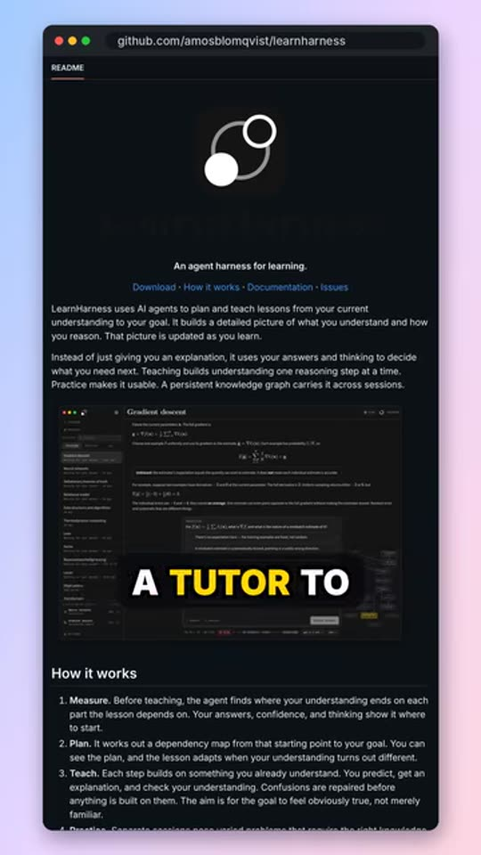 at 1s
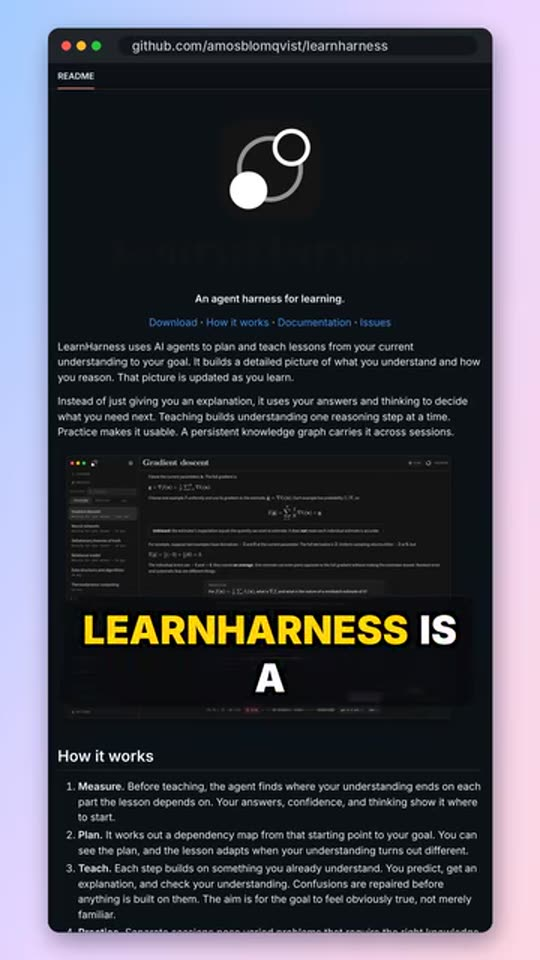 at 3s
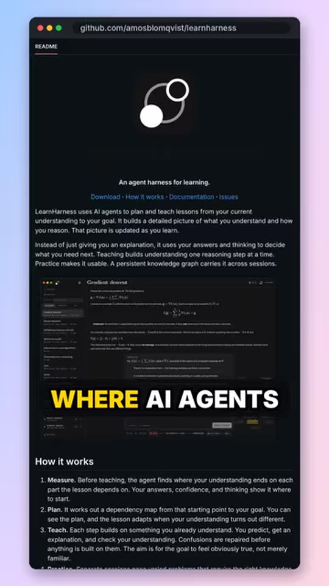 at 5s
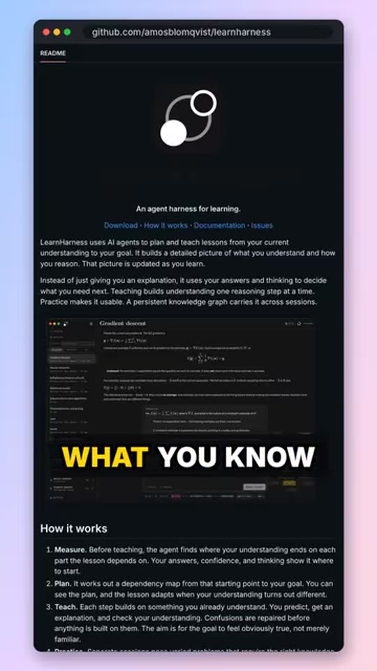 at 7s
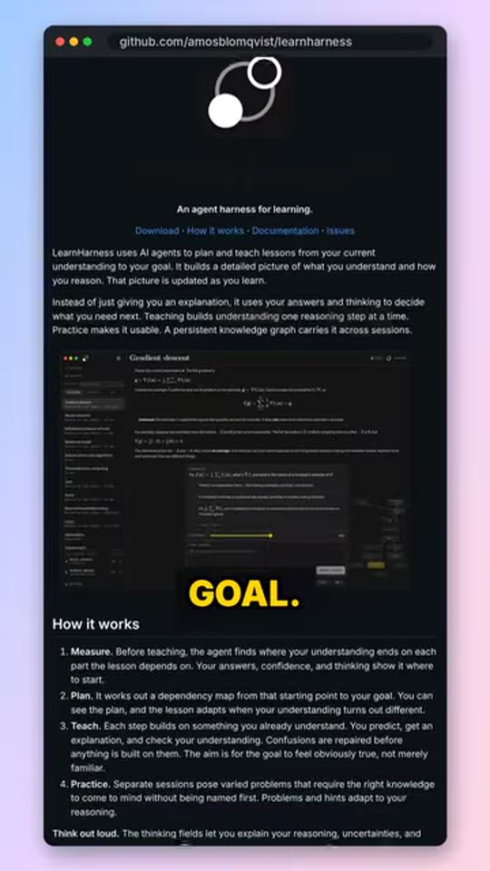 at 9.1s
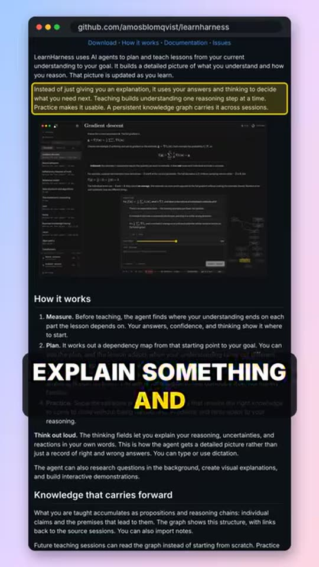 at 11.1s
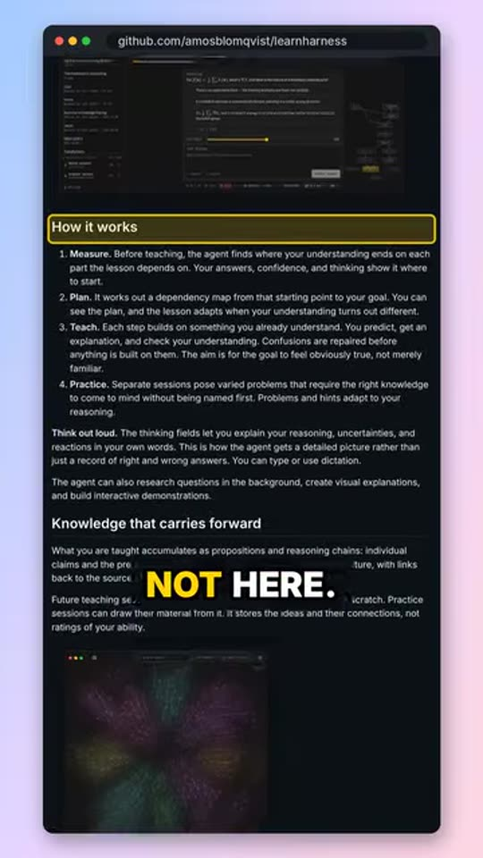 at 13.1s
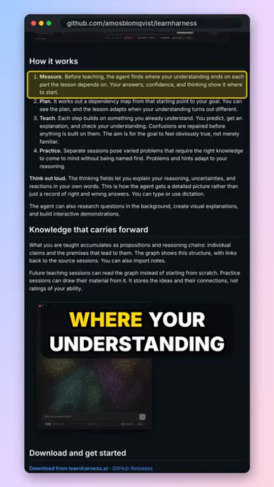 at 15.1s
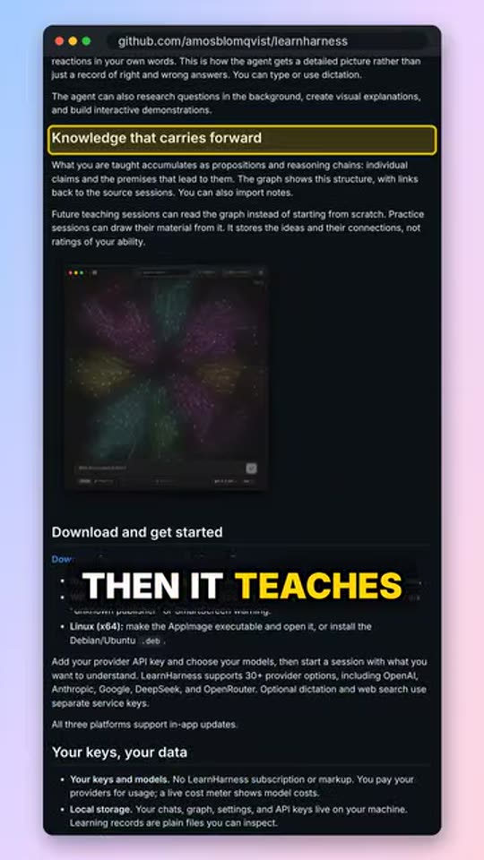 at 17.1s
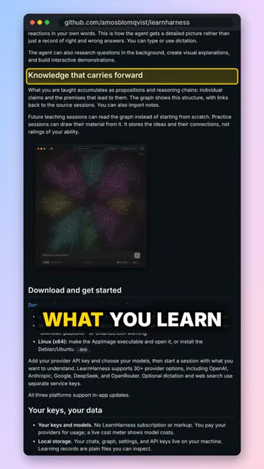 at 19.1s
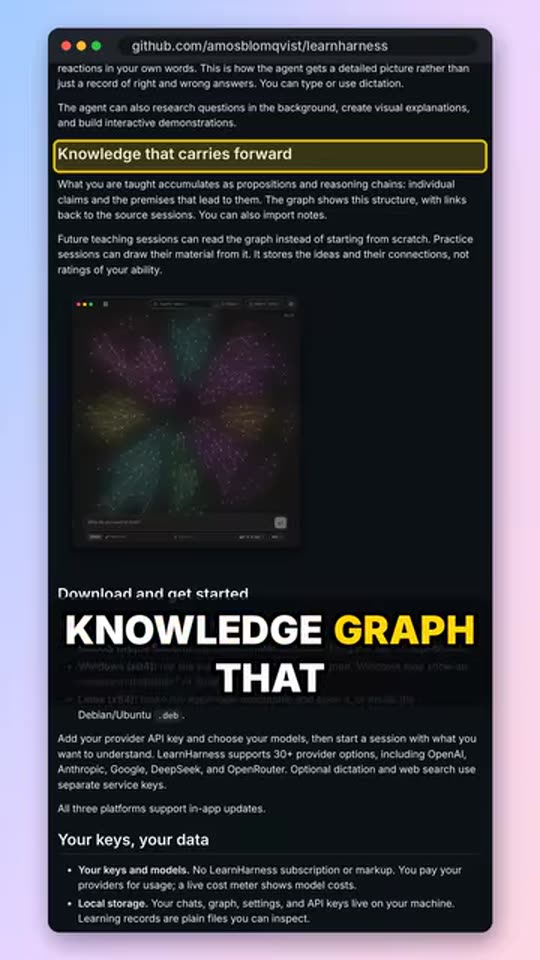 at 21.1s
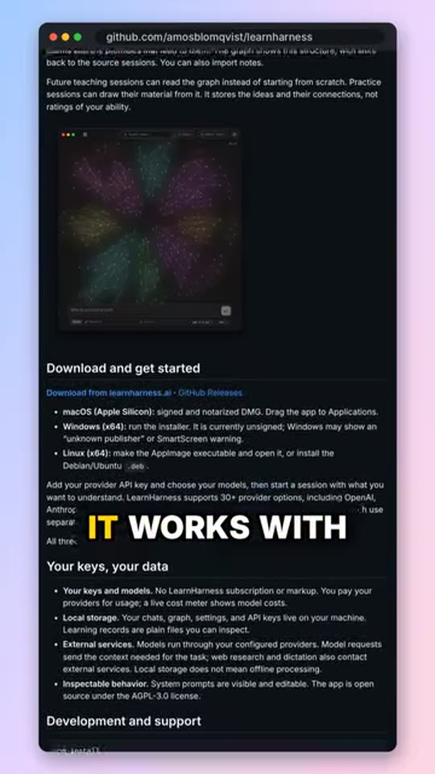 at 23.1s
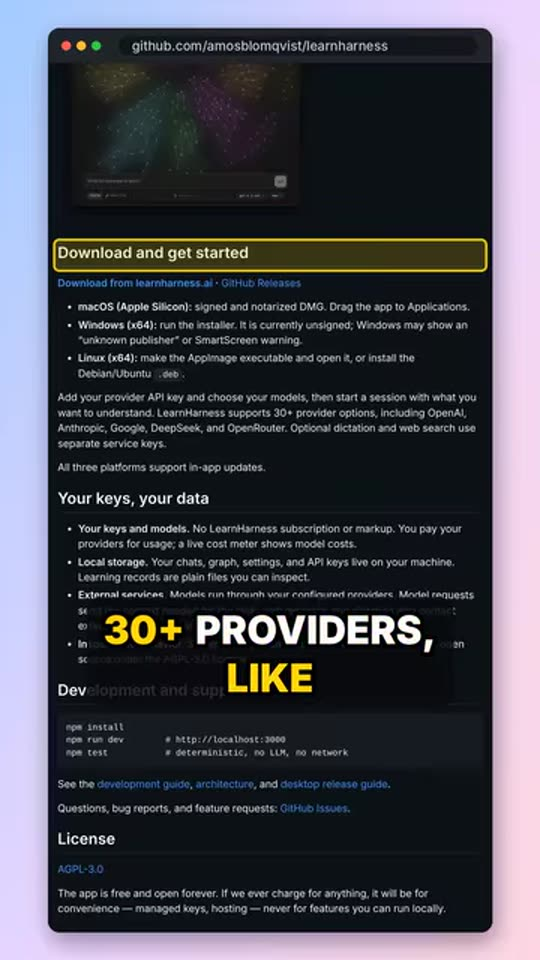 at 25.2s
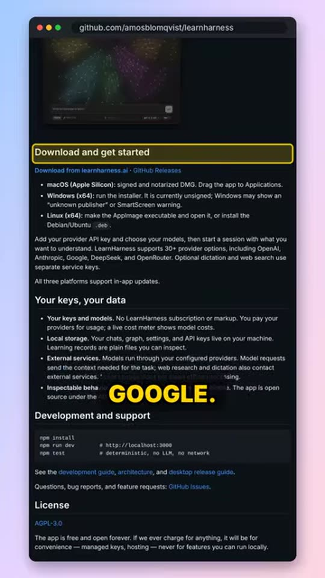 at 27.2s
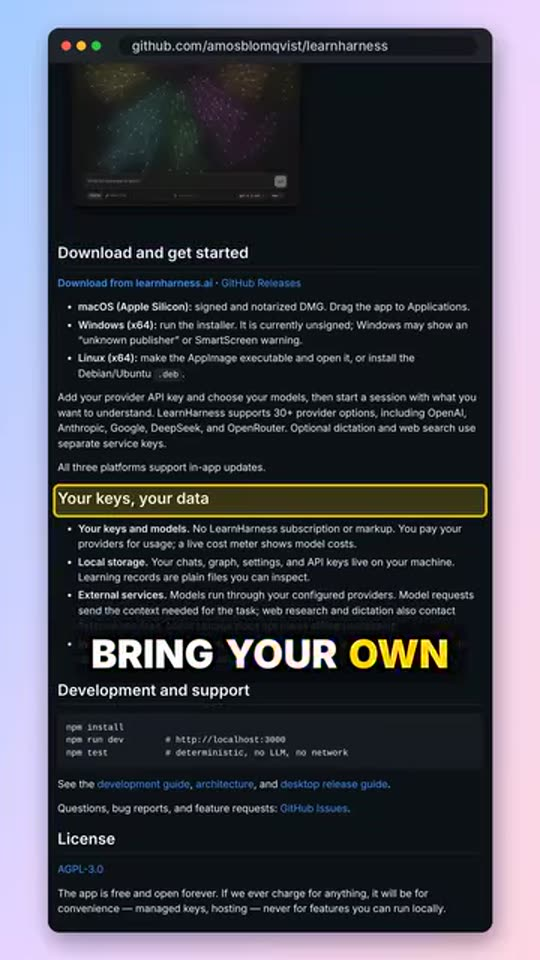 at 29.2s
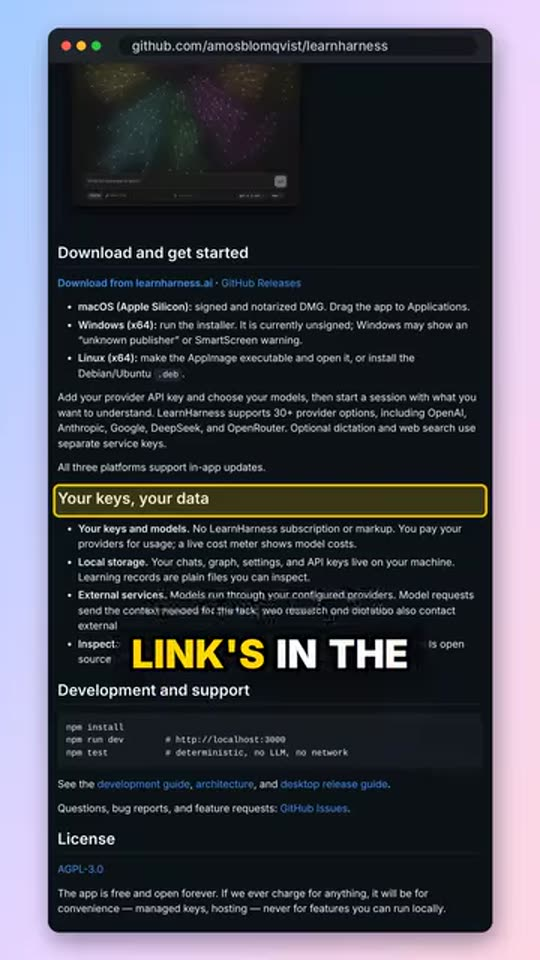 at 31.2s
