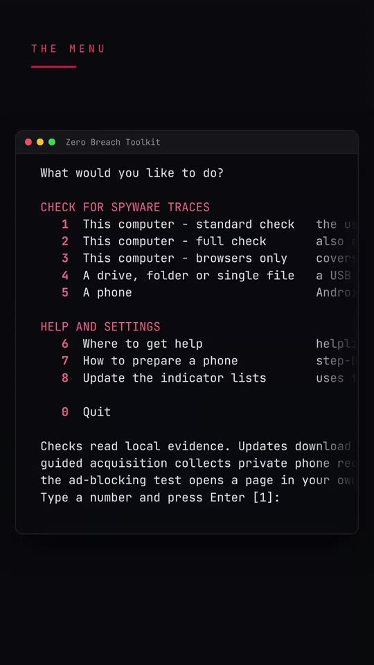
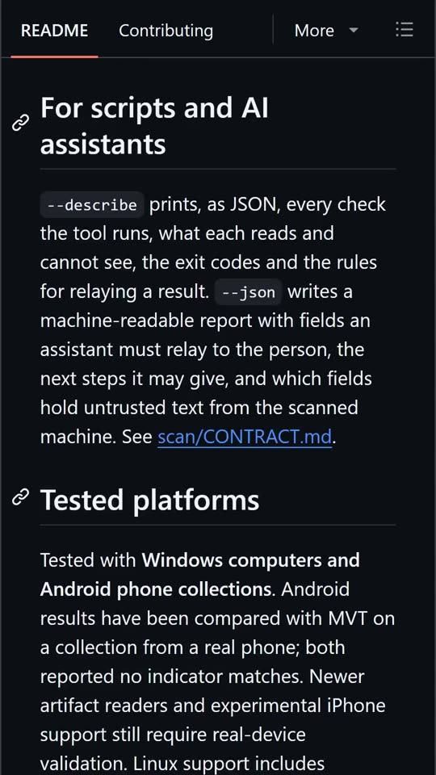
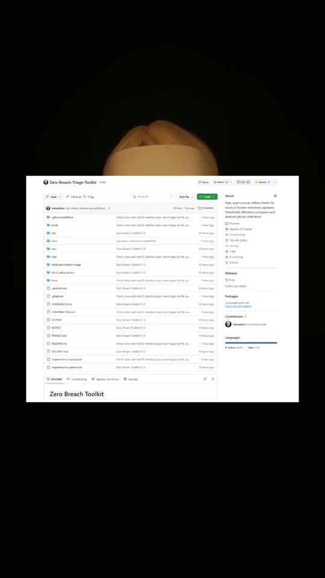

# Reel by ArchiveGenocide

- **URL:** https://www.instagram.com/reel/DfAkXOeIRBm/?psln=NG1ycm43ZzBuamgy
- **Shared:** 2026-10-28 16:31 UTC
- **Duration:** 117s
- **Spoken language:** en

## Caption

We have released Zero Breach Toolkit, our second free open sourced tool capable of detecting over 12,100 traces of Israeli & other spyware on your devices. It works on Windows, Linux, Mac, Android and Iphones.

You can download it here: https://github.com/interplains/Zero-Breach-Toolkit

Inside the folder with the tools run: python -X utf8 scan/zero-breach-toolkit.py

It never writes to disk, connects to the internet, or ask for admin rights, it takes around 10-15 minutes to run depending on the device. 

This project is fully open source, so feel free to take the code and use it to create your own tools. 

If you find some spyware on your device, consider sending it to us via telegram. Leave us a star on GitHub if the tool helped you. 

Follow our backup @archive.genocide1

God bless.

## Transcript

[0:00] We have released our second and far more powerful open-source tool, Zero Breach Toolkit, which
[0:06] can detect over 12,100 indicators of Israeli spyware on your devices.
[0:12] From Pegasus, Candiru, Paragon's Graphite, Quadream, Stalkerware, and more.
[0:20] You can download it from our GitHub link in the description below.
[0:24] The tool is read-only.
[0:27] It never goes online and never asks for admin rights.
[0:31] It works on Windows, Linux, Android, macOS, and it can do iPhones if you create a backup
[0:38] file first, then scan the backup file.
[0:42] You will need Python installed to use it.
[0:45] It includes a toolkit to investigate when you find something, and steps to report them.
[0:51] If you find a piece of malware, report it to us on our telegram.
[0:55] We advise you not to delete anything you find before sending us a copy.
[1:00] It will also check your browser settings if you have ads blocked, and tell you if any
[1:05] of your profiles touched the hundreds of thousands of recently infected ads Israeli
[1:10] spyware was using.
[1:12] We included a skill for your AIs to use the tool too, which should make it easier
[1:16] for non-tech savvy users to use.
[1:19] Just point your AI to it, and it will know what to do.
[1:23] We hope this tool helps you guys.
[1:25] Feel free to take the source code and create your own improved tools with it.
[1:29] You can also suggest improvements or upgrades on our GitHub, and we will take a look at
[1:34] them.
[1:35] We will be expanding its capability to reach Android-based TVs and other home devices
[1:40] in the coming weeks.
[1:42] If the tool helped you, please consider leaving us a star on GitHub.
[1:46] God bless.

## Frames

 at 1.3s
 at 3.9s
 at 6.5s
 at 9.1s
 at 11.7s
 at 14.3s
 at 16.9s
 at 19.5s
 at 22.1s
 at 24.7s
 at 27.3s
 at 30s
 at 32.6s
 at 35.2s
 at 37.8s
 at 40.4s
 at 43s
 at 45.6s
 at 48.2s
 at 50.8s
 at 53.4s
 at 56s
 at 58.6s
 at 61.2s
 at 63.8s
 at 66.4s
 at 69s
 at 71.6s
 at 74.2s
 at 76.8s
 at 79.4s
 at 82s
 at 84.7s
 at 87.3s
 at 89.9s
 at 92.5s
 at 95.1s
 at 97.7s
 at 100.3s
 at 102.9s
 at 105.5s
 at 108.1s
 at 110.7s
 at 113.3s
 at 115.9s
