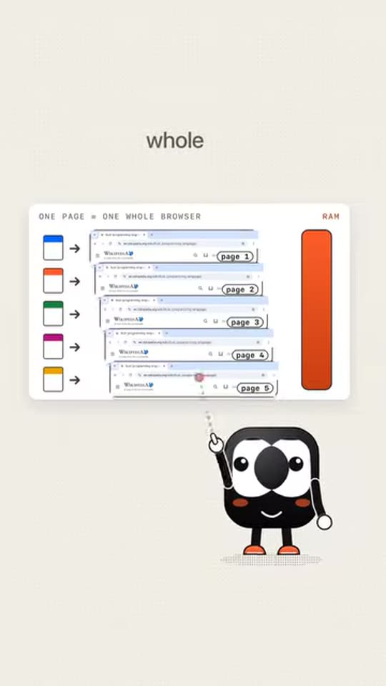
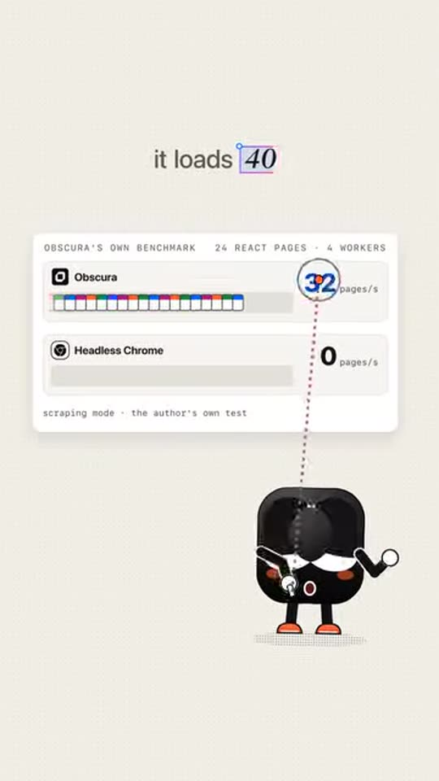
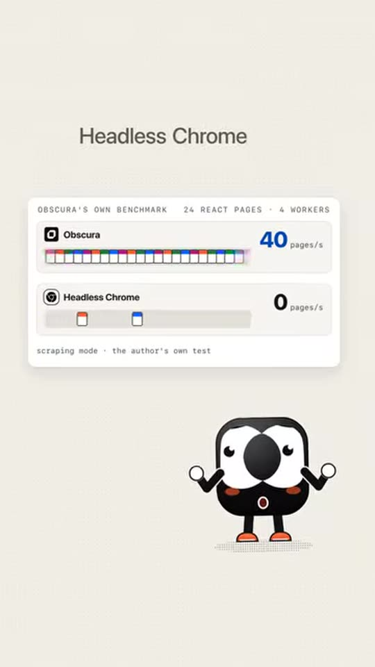

# Reel by Appscribed

- **URL:** https://www.instagram.com/reel/DfGZ81HMz43/?vrfl=MWdwNDhzMDk2b3k5bw==
- **Shared:** 2026-10-30 10:51 UTC
- **Duration:** 42s
- **Spoken language:** en

## Caption

Your AI agents can now browse the web with a free, open source browser built just for them. 🦀

It's called Obscura, written in Rust. In its own benchmark it loads 40 pages a second where headless Chrome loads 3, and uses about 30 MB of memory per page where Chrome uses nearly 200. 

It works with Puppeteer and Playwright and has an MCP server, so Claude Desktop or Cursor can drive it.

One rule: respect the sites you scrape (their terms and robots.txt).
Want the link? 

Comment BROWSER and I'll send it to you. 

Follow @appscribed for more AI tools.

#ai #aiagents #opensource #rust #webscraping #puppeteer #playwright #mcp #claude #cursor #devtools #automation

## Transcript

[0:00] Your AI agents can now browse the web
[0:02] with a free open source browser built just for them.
[0:05] Right now, most AI agents use Chrome,
[0:07] which was made for humans.
[0:08] So every single page means starting up
[0:10] a whole heavy browser.
[0:12] This developer built a new one in Rust,
[0:14] designed for how AI agents work.
[0:16] It's called Obscura.
[0:17] In its own benchmark, it loads 40 pages a second.
[0:20] Headless Chrome loads three.
[0:22] It uses about 30 megabytes of memory,
[0:24] where Chrome uses nearly 200.
[0:26] It works with Puppeteer and Playwright,
[0:28] and it has an MCP server.
[0:29] So Claude Desktop or Cursor can drive it.
[0:32] It already has over 29,000 stars on GitHub.
[0:35] One rule, respect the sites you scrape.
[0:37] So wanna check it out?
[0:38] Just comment browser, and I'll send you the link.

## Frames

 at 1s
 at 3s
 at 5s
 at 7.1s
 at 9.1s
 at 11.1s
 at 13.1s
 at 15.1s
 at 17.2s
 at 19.2s
 at 21.2s
 at 23.2s
 at 25.2s
 at 27.3s
 at 29.3s
 at 31.3s
 at 33.3s
 at 35.3s
 at 37.4s
 at 39.4s
 at 41.4s
