# Reel by Prinon Turio

- **URL:** https://www.instagram.com/reel/DgAz_FWhJMv/?lqvp=MTNvbXN2aXpuNDVtZw==
- **Shared:** 2026-11-26 15:10 UTC
- **Duration:** 36s
- **Spoken language:** en

## Caption

Give your Claude Code agents a way to check their work. An Anthropic engineer built from a blank terminal all the way to a feedback loop. Save this for your next setup.
#ClaudeCode #AgenticCoding

## Transcript

[0:00] Your prompting days are over. That's coming from an anthropic engineer who just built her
[0:04] entire Claude code setup live in barely 10 minutes, starting from a completely empty terminal.
[0:09] You get to watch every step, and it's wild how fast this escalates.
[0:13] First, she sets up her agents. Then she puts those agents into loops.
[0:17] Then she moves to graphs, and by the end she has a system that literally improves itself.
[0:22] And this isn't some experimental side demo. 95% of Anthropics engineers already run
[0:27] self-improving loops and graphs of what's next. Most people are still spending all-day
[0:32] tweaking prompts, while the people who built Claude are just building systems around it.

## Frames

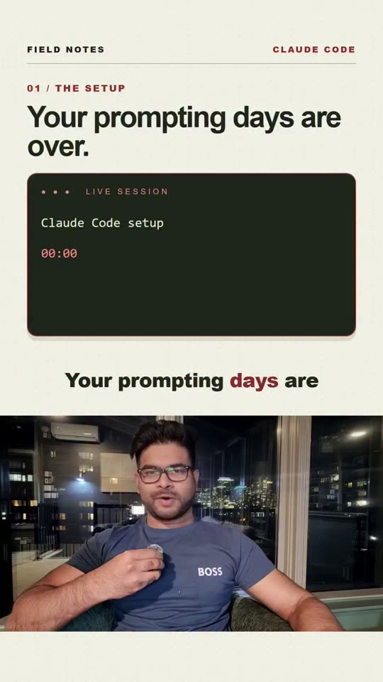 at 1s
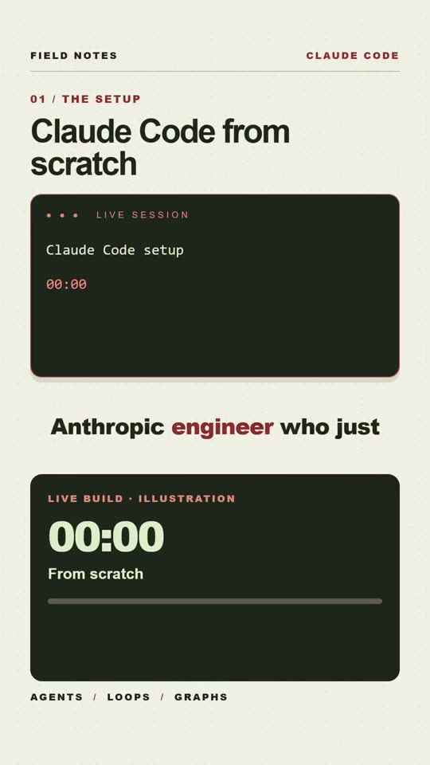 at 3s
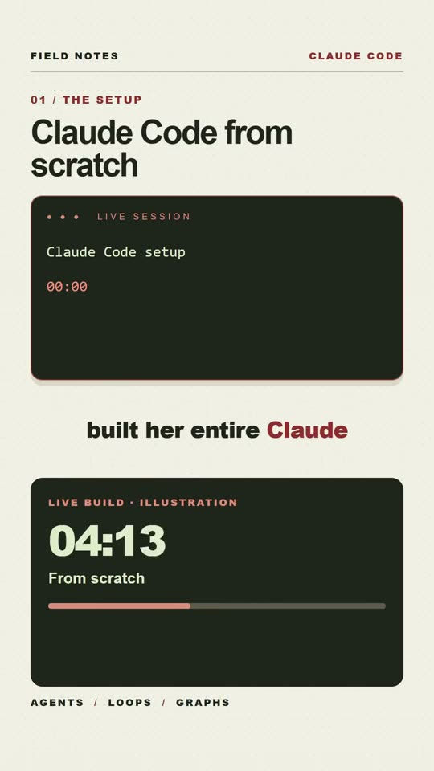 at 5s
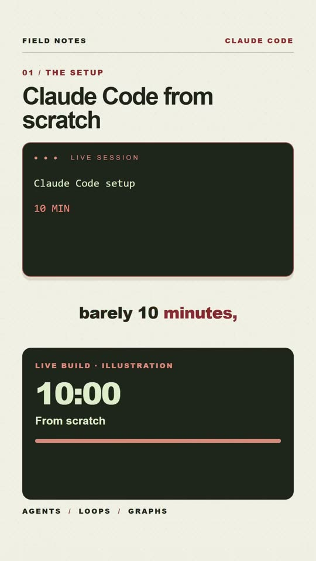 at 7s
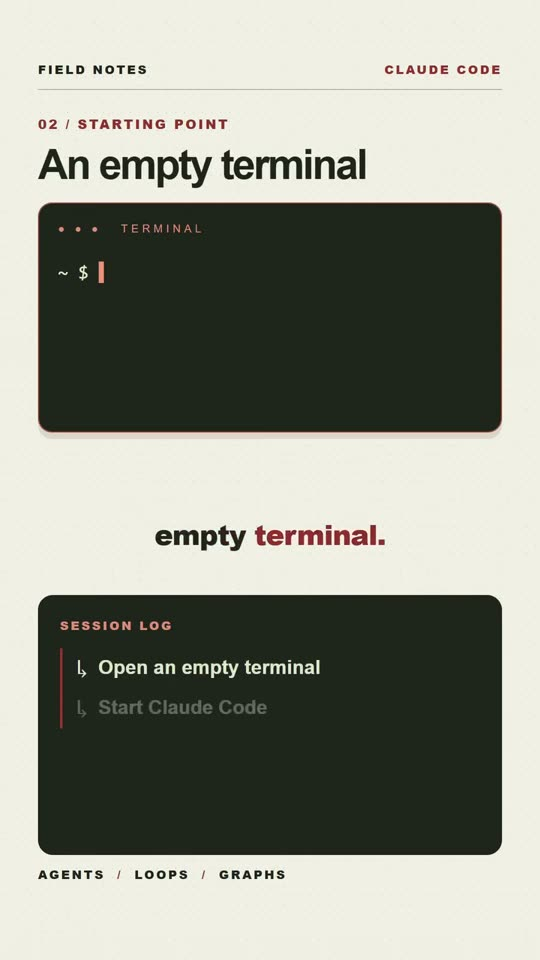 at 9s
 at 11s
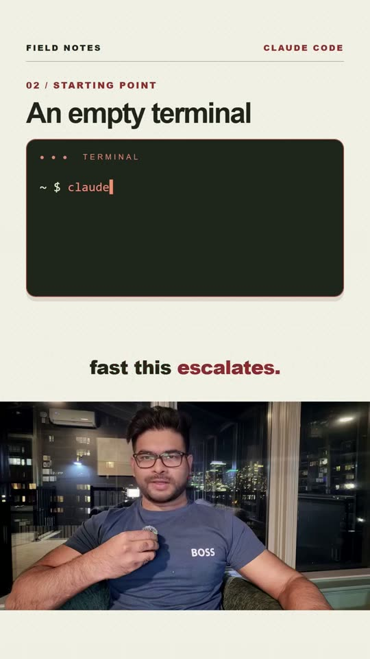 at 13s
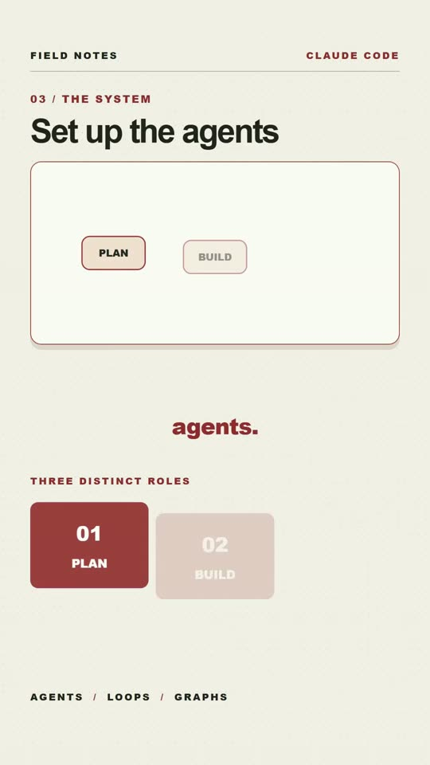 at 15s
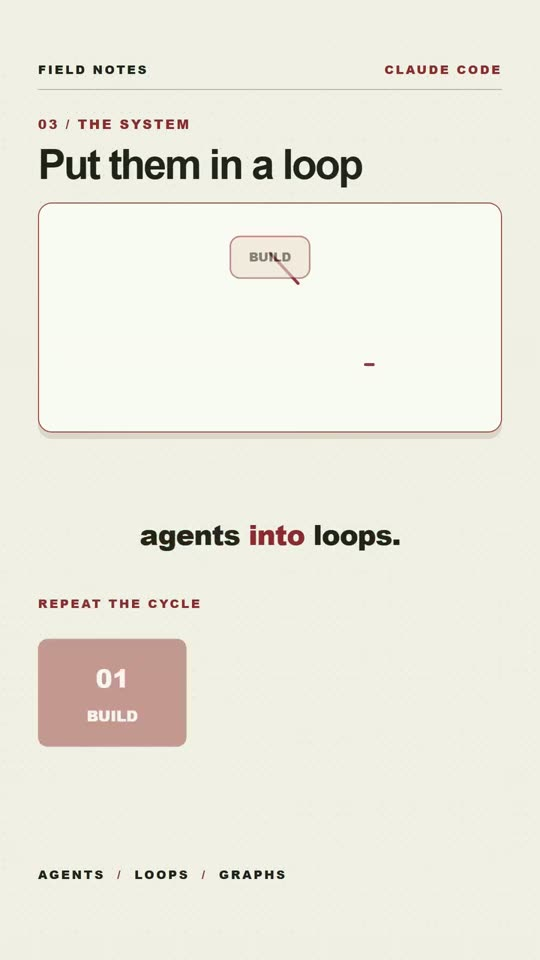 at 17s
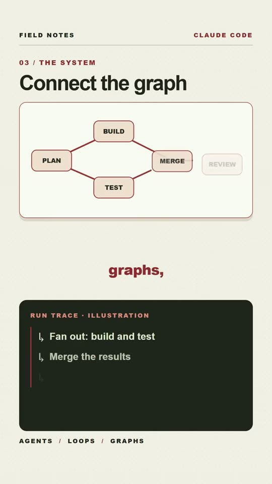 at 19s
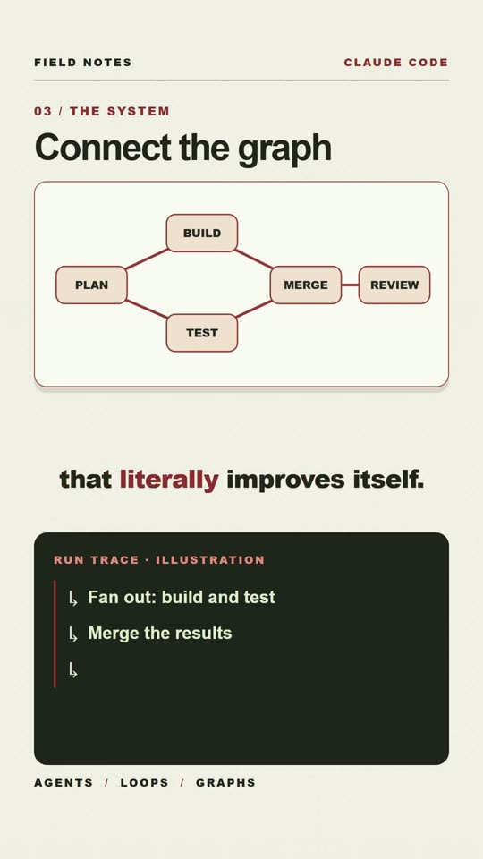 at 21s
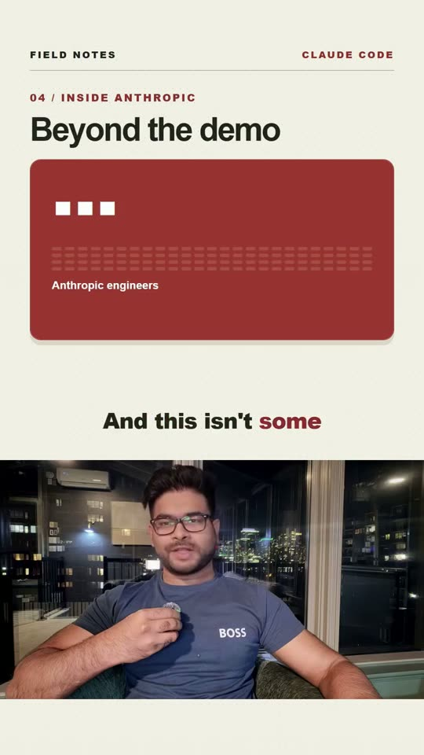 at 23s
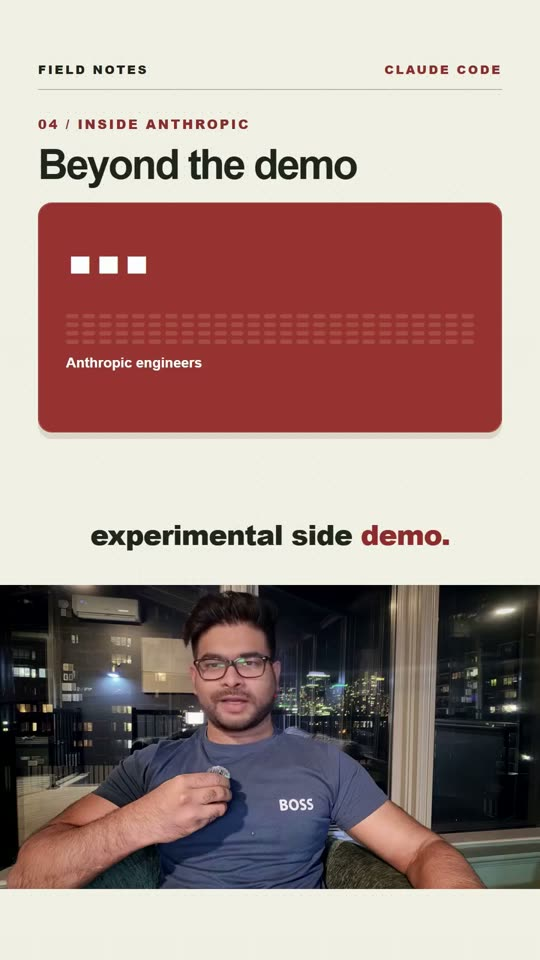 at 25s
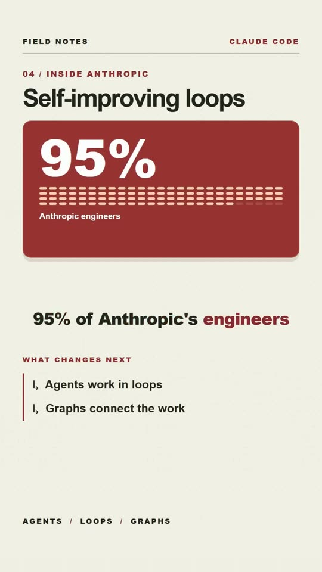 at 27s
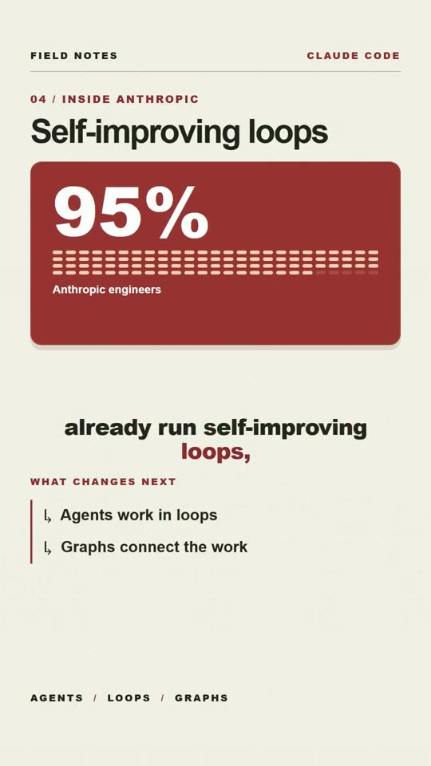 at 29s
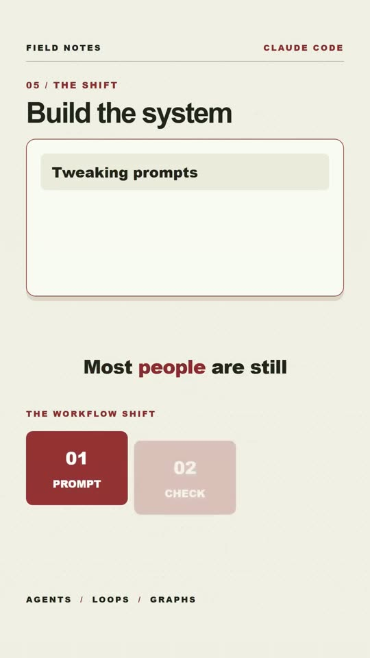 at 31s
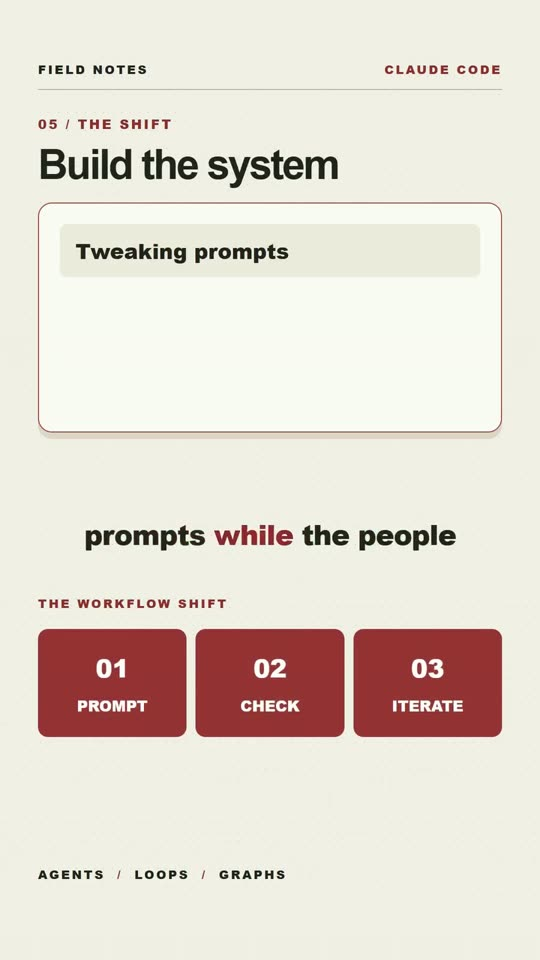 at 33s
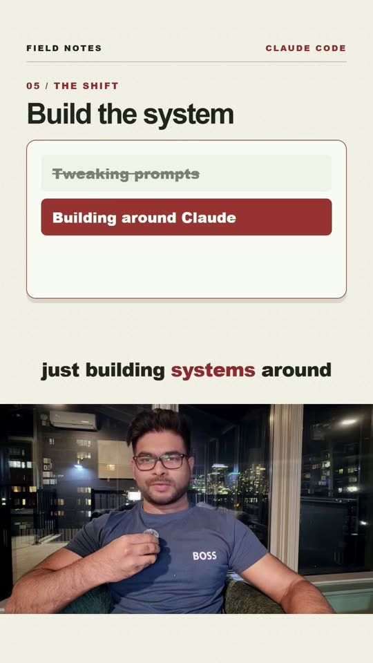 at 35.1s
