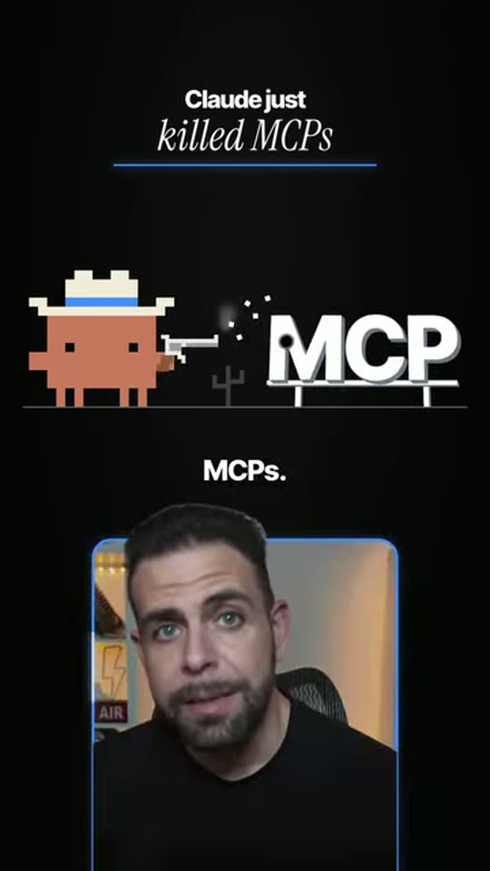
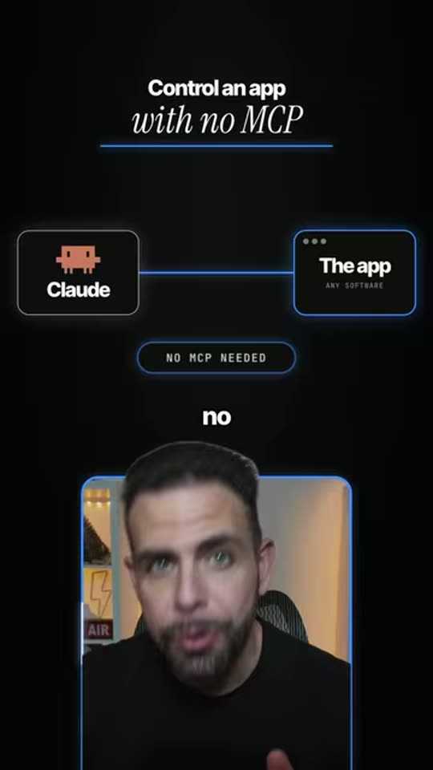
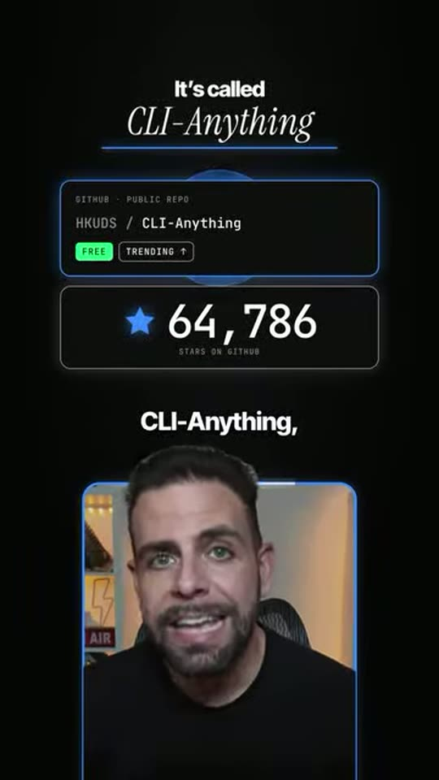
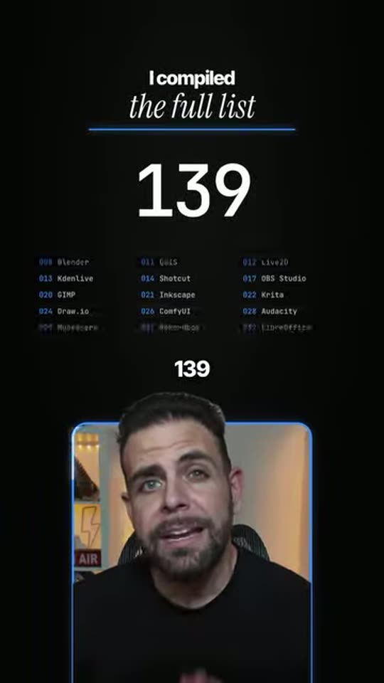
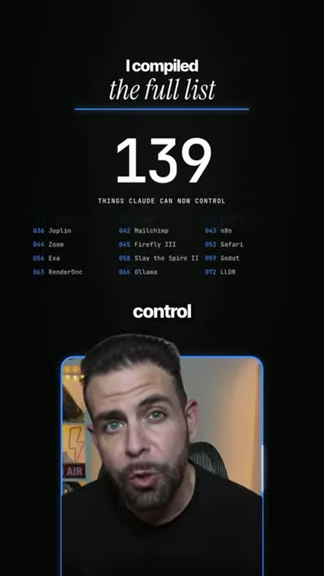

# Reel by Dylan Watkins

- **URL:** https://www.instagram.com/reel/DgLy3uVSQ2r/?lqvp=MXhiYmF2aGNmb20zZw==
- **Shared:** 2026-11-26 01:47 UTC
- **Duration:** 52s
- **Spoken language:** en

## Caption

Comment “CLI” and I’ll send you the repo, plus my list of 139 things Claude can control with it.

What didn’t fit in the video:

You don’t have to build anything to try it. There’s a hub with about 80 apps already done. Two commands:
pip install cli-anything-hub
cli-hub install blender

Building a new one is a single command inside Claude Code. You type /cli-anything and point it at the app’s code. Then it runs 7 steps on its own: reads the code, designs the commands, builds them, plans the tests, writes the tests, documents everything, and installs it.

Every tool it makes comes with a help menu and clean JSON output. That’s how Claude learns a tool it has never seen before.

The biggest ones so far: FreeCAD has 258 commands. Mailchimp has 303. In the repo’s own demo, an agent built a Mars rover model in CAD, one command at a time.

It came out of a research lab at the University of Hong Kong, and it’s free.

What you need:
Claude Code (Cursor and Codex work too)
Python 3.10 or newer
The real app installed. It drives Blender, it doesn’t replace it

Where it misses: it needs the app’s source code or an API to work from, so closed apps are hit or miss. Some of the ready-made ones don’t install cleanly yet. Test the one you want first.

And if an app already has a good MCP, keep using it. This is for the thousands of apps that never built one.

Comment “CLI” and it’s yours.

#claudeai #claudecode #aitools #aiautomation #opensource

## Transcript

[0:00] Claude just killed MCPs.
[0:01] Claude can now take control of an app,
[0:04] even if it has no MCP.
[0:05] So the apps you've been clicking through by hand,
[0:08] Claude can now run them for you.
[0:09] There's a new GitHub repo blowing up right now
[0:11] with over 64,000 stars.
[0:13] It's called CLI Anything,
[0:15] and it solves one of the most painful problems in AI.
[0:18] Before, if you wanted Claude to work with another app,
[0:21] you'd need an API or an MCP.
[0:24] Think of those like handshakes between two apps.
[0:26] No handshakes, no way to pass data,
[0:28] but most apps never built one.
[0:30] So CLI Anything built its own.
[0:32] It reads the app's source code
[0:34] and writes a command line for it,
[0:36] which means Claude can now take direct control
[0:38] from laser cutters to embroidering machines and blender.
[0:41] It even plays video games.
[0:43] I compiled 139 of the craziest things
[0:45] Claude can now control using CLI Anything.
[0:48] Comment CLI and I'll shoot to the repo
[0:50] and the full list right over.

## Frames

 at 1s
 at 3s
 at 5s
 at 7s
 at 9s
 at 11s
 at 13s
 at 14.9s
 at 16.9s
 at 18.9s
 at 20.9s
 at 22.9s
 at 24.9s
 at 26.9s
 at 28.9s
 at 30.9s
 at 32.9s
 at 34.9s
 at 36.9s
 at 38.9s
 at 40.8s
 at 42.8s
 at 44.8s
 at 46.8s
 at 48.8s
 at 50.8s
