# Reel by Sansser

- **URL:** https://www.instagram.com/reel/DgNJdLjB5Mq/?hvrq=MTZ2bXJmOW43Y3RoaA==
- **Shared:** 2026-11-26 15:05 UTC
- **Duration:** 52s
- **Spoken language:** en

## Caption

The nine fastest-growing repos on GitHub this month, and the last one is trying to run GTA 6 on PC.

T3 Code leads with 49.3K new stars, and it lets you control Claude Code and Codex from any computer or straight from your phone. Cloudflare's security audit skill, Impeccable and Hallmark are in there too.

Comment STARS and I'll send you all nine with the install command for each one.

How long before Rockstar shuts the GTA 6 one down?

#GitHub #ClaudeCode #OpenSource

## Transcript

[0:00] These are the nine fastest growing repos on GitHub right now.
[0:03] And all nine are free.
[0:04] T3 code is right at the top,
[0:06] and it lets you control cloud code and codex
[0:08] from any computer or straight from your phone.
[0:10] Then there's a plugin that says it gives you
[0:11] deep seek and Kimmy for free.
[0:13] No API key.
[0:14] And next up is Cloudflare security audit skill,
[0:16] which checks your code and double checks every finding.
[0:18] Then impeccable and hallmark.
[0:20] Two skills that make your site look way less AI made.
[0:22] After that comes Sherlock,
[0:23] which tracks down someone's social accounts
[0:25] across sites from one username.
[0:27] Then open mousebot,
[0:28] an open source bot that gets its own virtual computer
[0:30] to work on, and magpie.
[0:32] So you can run codex on deep seek
[0:33] or cloud code on Kimmy from your menu bar.
[0:35] And the wildest one is the last one,
[0:37] a project trying to get GTA 6 running on PC.
[0:40] And it pulled almost 13,000 stars in less than three days.
[0:43] Honestly, I give it a week before Rockstar notices.
[0:45] Comment stars and I'll send you all nine links.
[0:47] And make sure you follow
[0:48] because Instagram only lets me DM the people who follow me.

## Frames

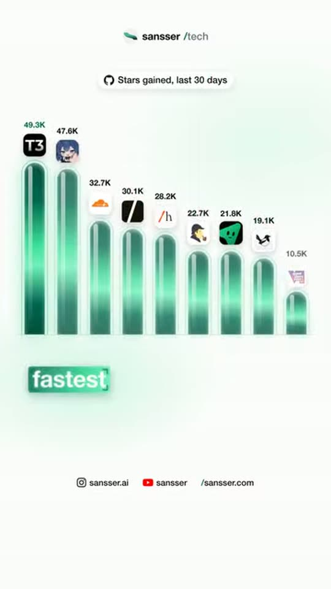 at 1s
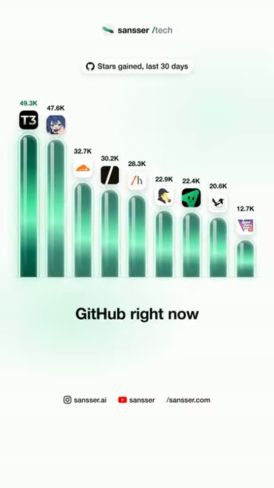 at 3s
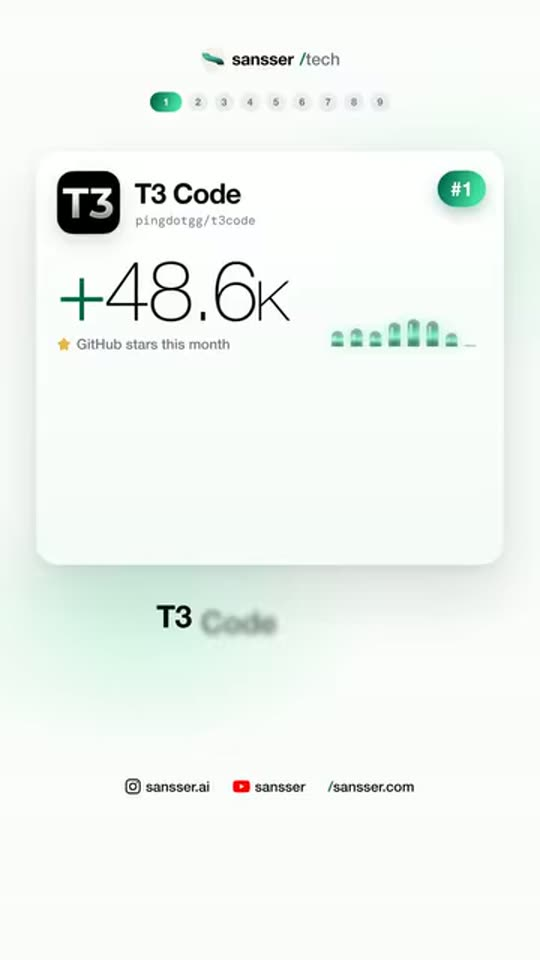 at 5s
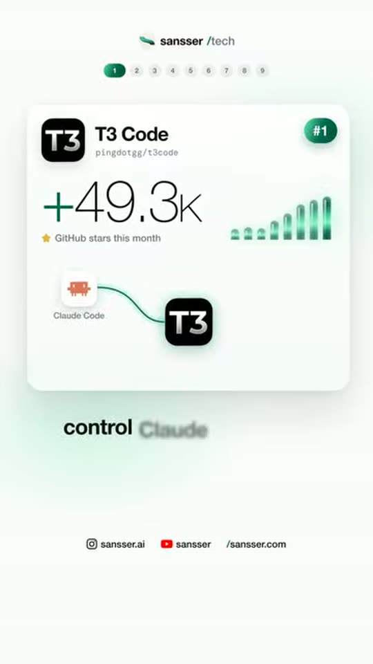 at 7s
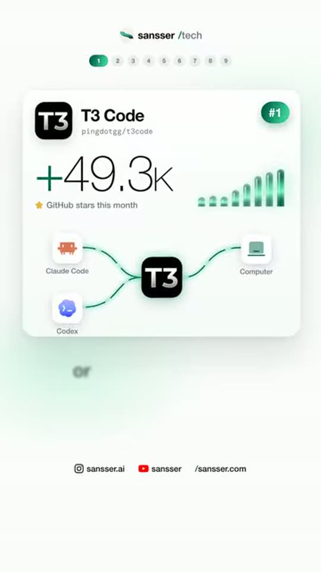 at 9s
 at 11s
 at 13s
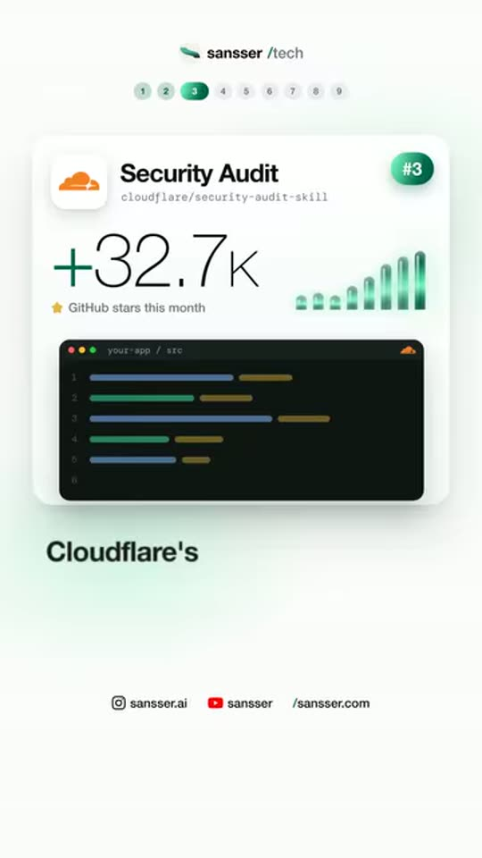 at 15s
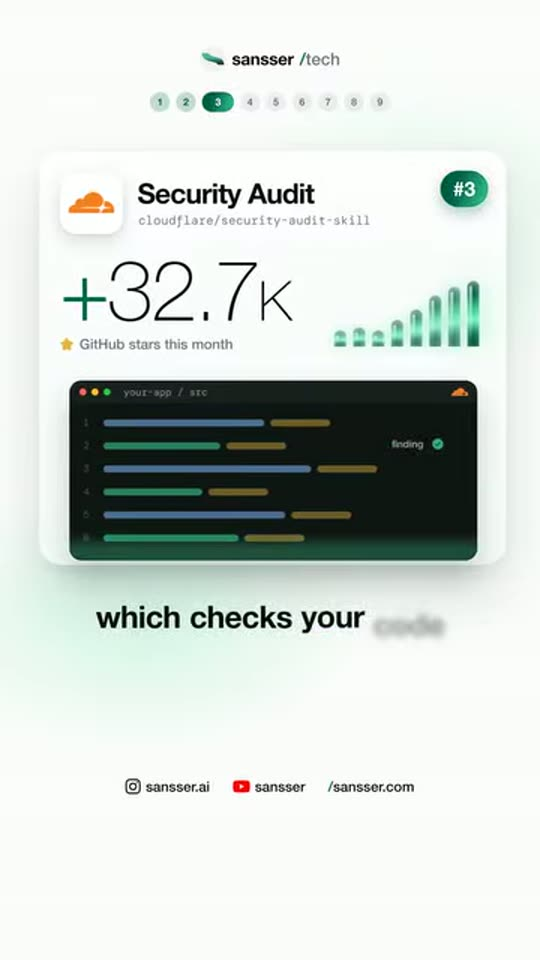 at 17s
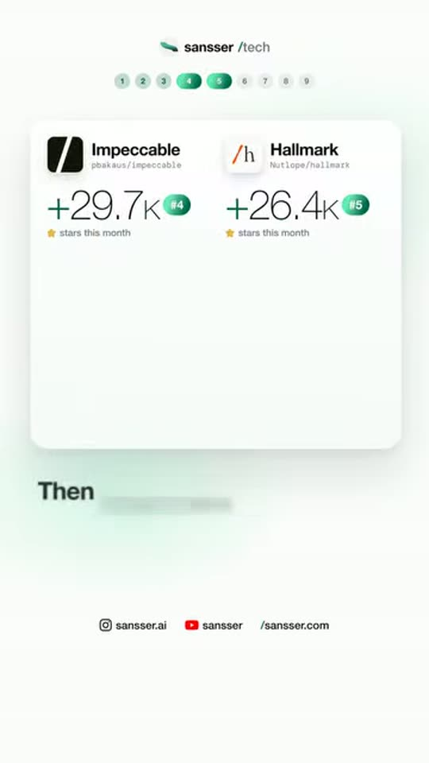 at 19s
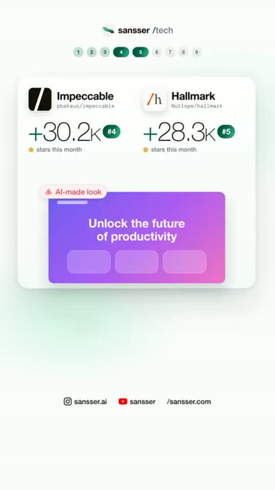 at 21s
 at 23s
 at 25s
 at 27.1s
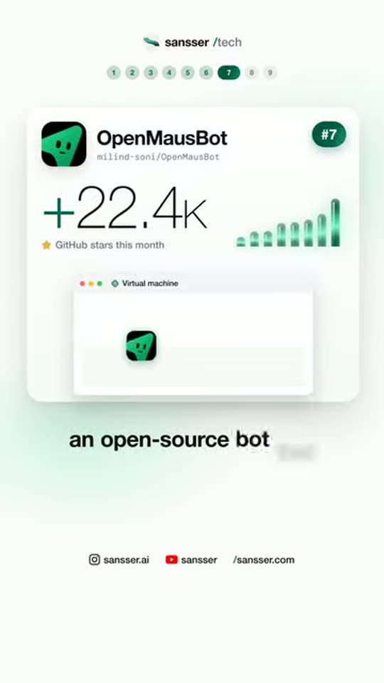 at 29.1s
 at 31.1s
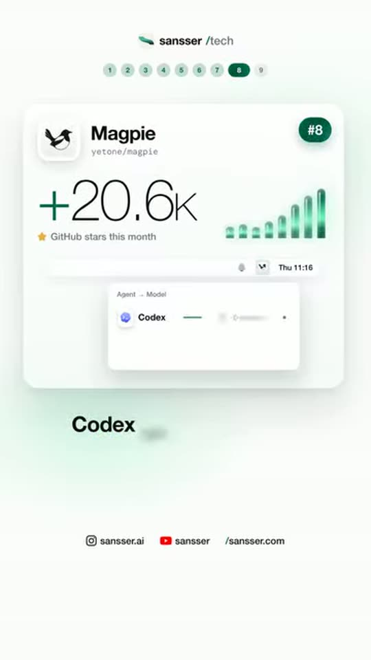 at 33.1s
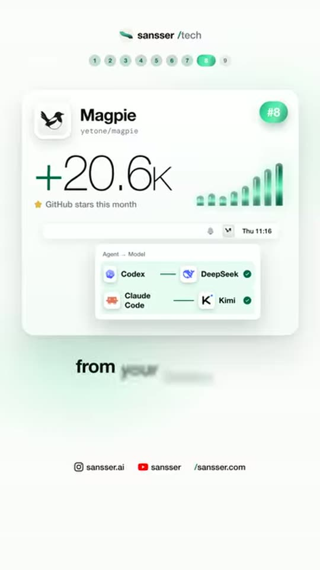 at 35.1s
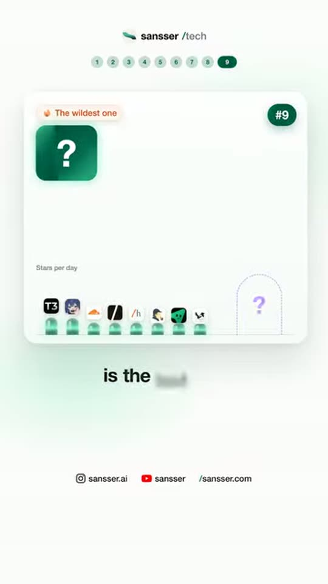 at 37.1s
 at 39.1s
 at 41.1s
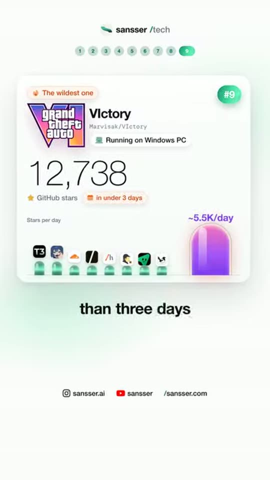 at 43.1s
 at 45.1s
 at 47.1s
 at 49.1s
 at 51.1s
